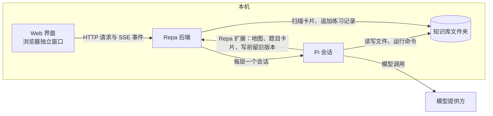

# 自用骨架：文件夹即知识库，每层一段对话

状态：提案

## 问题

转向自用以后，旧主线已经移出，保存在标签 `pre-slim`。维护者要的是一个每天打开就能用的学习助手：学过的东西在一个自己能直接打开书写的知识库里；在某个主题里和 Agent 对话时，不必重新交代背景，也不会被别的主题的细节干扰；Agent 能出题考他，记下考过什么、答得怎样，到了他定的日子提醒他复习；需要反复用的能力，Agent 能自己写成小工具，当场用上。

约束已在根目录 [AGENTS.md](../../../../AGENTS.md) 中定下：只在 Linux 上自用，不分发，不兼容旧数据；现在不建学生模型，练习不作为掌握的证据，复习日期由学习者告诉 Agent；对话在 Repa 自己的网页里进行，界面是一层薄的视图，布局不定死；机制只为实际遇到的问题而加，各部分写明预计行数。

旧主线的后端约 3 万行源码。其中一大块是围绕静态课程的学习插件，转向后不再需要；底座的 1.3 万行里，相当一部分在替 Pi 补它当时不做的事，或防御设想中的故障。按 Pi 1.6.1 核对的结果（见下文“与 Pi 的分界”），运行中注册工具、会话的保存与续接、逐层读取项目说明、按段追加的系统提示都已由 Pi 提供，防御在自用下也不再需要。所以本设计的出发点是：Pi 和文件系统已经能做的事直接用，Repa 只写知识库的约定、每一轮交给模型的上下文、题目卡片和界面。

## 做法

### 总览

下图是目标设计。Repa 的后端是本机的一个 Node 进程，界面在浏览器的独立窗口里打开；对话由后端里的 Pi 会话承担，Repa 以一个 Pi 扩展接入会话。



### 知识库是一个文件夹

知识库默认在 `~/Repa`，启动时可以指定别处。文件夹就是层次，Markdown 文件就是卡片，Repa 自己的数据放在 `.repa/` 里：

```text
~/Repa/
  AGENTS.md          对所有学习的要求（可选）
  CSAPP/
    AGENTS.md        对这一层的要求（可选）
    虚拟内存.md      一张卡片
    第9章/
      页表.md
  论文/
  .agents/skills/    技能，Pi 原生的格式
  .repa/
    log.jsonl        练习记录，只追加
    versions/        Agent 改写前的旧版本
    sessions/        对话，Pi 的格式
    tools/           小工具，即 Pi 扩展
```

除 `AGENTS.md` 和以点开头的文件夹之外，每个 Markdown 文件都是一张卡片，文件名就是标题。卡片用任何编辑器都能直接打开书写，写法与 Obsidian 相同：链接写作 `[[页表]]`，可以带显示文字，写作 `[[页表|PT]]`；标题重名时先找同一层的。文件头只有程序用到的两项，都可以不写：

```markdown
---
id: k7f3qa
review: 2026-11-29
---

虚拟内存让每个进程以为自己独占一大块连续的地址……

和 [[页表]] 一起看。
```

`id` 是练习记录指向这张卡片的依据。它由程序在这张卡片第一次被练习时写入，此后卡片改名或移动，记录仍然跟着它。`review` 是复习日期：你告诉 Agent，或在卡片页上选定日期时写入；到了这一天，首页列出这张卡片。卡片正文是你的文字：Repa 的程序只写文件头，不动正文；Agent 改正文时怎样处理，见下文“Agent 改卡片”。

### 层就是文件夹

每个文件夹是一层，知识库的根是最上层。对话总在某一层里进行：Repa 以这一层的文件夹为工作目录创建 Pi 会话，于是下面三件事由 Pi 直接承担。

- Pi 从文件系统的根逐级读到工作目录，把沿途每个文件夹的 `AGENTS.md` 交给模型（`dist/core/resource-loader.js`）。所以对话读得到这一层和所有上层的要求，读不到兄弟层的。Repa 只把读取的范围限制在知识库之内，免得知识库外层恰好有一份 `AGENTS.md` 混进来；核对时就出现过一次，仓库根目录的 `AGENTS.md` 被读进了测试目录的会话。
- Pi 负责会话的保存、续接和压缩。Repa 把每层的对话存在 `.repa/sessions/` 下按层分开的目录里，打开一层时接着这一层最近的对话，也可以新开一段，或翻回以前的。
- Agent 的文件工具以这一层为当前目录，相对路径就落在这一层。

隔离指的是默认交给模型什么，不是禁止访问。需要别处的内容时，Agent 按链接或搜索去读整个知识库，这沿用了[状态的范围](https://github.com/Utopia-V/Repa/blob/pre-slim/.agents/notes/proposed/architecture/2026-11-15-state-scope.md)提案“摘要是线索，原文按需去取”的做法。

你改了某一层的 `AGENTS.md` 以后，从下一条消息起生效：Repa 在发出消息前发现这条链上的文件变了，就让 Pi 重新加载一次。

### 每一轮交给模型的上下文

每次你发出一条消息，Repa 先算出这一层的“地图”，作为几个命名的系统提示段落交给 Pi。Pi 只在段落的文字变了时追加变了的那几段，没变的不重发（`dist/core/system-prompt.js` 的 `diffSystemPromptSections`），提示缓存因此保持有效。地图是对文件和练习记录的一次查询，不另存一份：

```text
【位置】知识库 / CSAPP / 第9章（上层：CSAPP 42 张卡片；知识库 130 张）
【这一层的卡片】12 张
- 页表：把虚拟页映射到物理页的表……
- TLB：……
【下一层】9.6 地址翻译（5 张）
【到期的复习】页表（今天）；TLB（逾期 2 天）
【最近没答好的练习】11-25 页表，部分对：漏了多级页表省空间的原因
【链到别处的卡片】哈希表（hot100）：……
```

卡片后面的一句取正文第一行的前 40 个字。为了不让地图随知识库一起变大，各项都有上限：这一层的卡片最多列 40 张，超出时列最近改过的 40 张并写明总数；下一层最多列 20 个；到期的复习和没答好的练习按这一层及以下统计，练习只列最近 5 次；链到别处的卡片最多 10 张。对话框顶部用一行显示同一份地图的概要，例如“CSAPP / 第9章 · 12 张卡片 · 2 张到期”，你能看到模型拿到了什么。

Pi 自带的系统提示把模型定位为编程助手。这一段不能单独删去，所以 Repa 用 Pi 的自定义提示整段换掉它，写明这是你的学习助手，以及卡片和文件头的约定、各个工具什么时候用，约 15 行。怎样教你，写在你自己的 `AGENTS.md` 里，由你修改。

### 练习与复习

Repa 给 Agent 三个工具：

| 工具 | 做什么 |
| --- | --- |
| `quiz` | 给出卡片和题面。对话里弹出一张题目卡片，等你作答；题面和作答记入练习记录，作答交回给 Agent。你关掉卡片，或在输入框里直接回话，交回的是“没有作答” |
| `grade` | 记下一次练习的结果（对、部分对、错）和一句讲评，显示在题目卡片上，也显示在知识卡片下面。不经题目卡片的练习也用它记，例如你在编辑器里做完的一道代码题 |
| `practice_history` | 取出一张卡片以前的题目、作答和结果。复习时 Agent 用它出题，可以重用旧题，也可以换一道 |

练习记录是 `.repa/log.jsonl`，一行一个事实，只追加，不改写：

```json
{"v":1,"t":"2026-11-26T15:02:11+08:00","kind":"quiz","id":"q8x2","card":"k7f3qa","question":"……","answer":"……"}
{"v":1,"t":"2026-11-26T15:03:40+08:00","kind":"grade","quiz":"q8x2","result":"partial","note":"漏了多级页表省空间的原因"}
```

现在没有任何东西从这些记录推算掌握程度。它们只用于在卡片下面显示、在地图里列出没答好的练习，以及复习时供 Agent 取用；以后需要学生模型时，直接在这些记录上重算。`v` 是格式版本，格式改变时提高它，旧记录给出明白的拒绝说明。

复习只看卡片文件头的 `review`。首页列出 `review` 不晚于今天的卡片，每张有一个“复习”按钮：它打开这张卡片，把对话切到卡片所在的层，并发出“复习「页表」”。Agent 用 `practice_history` 出题考你。考完以后，它去掉这张卡片的 `review`，除非你说了下一次的时间；它可以建议一个日期，你同意才写入。

### Agent 改卡片：改之前留旧版本

Agent 用 Pi 的 `write` 或 `edit` 写知识库里已有的文件之前，Repa 的扩展先把原文件复制到 `.repa/versions/<相对路径>/<时间>-<工具调用编号>.md`。Pi 在工具运行之前依次等待这类处理完成，所以复制总在改写之前。对话里每次改动显示为一行：`edit` 按它的参数并排显示原文与新文，`write` 显示“整篇改写”。每行都有“撤回”，把文件恢复成改动前的版本；撤回之前，当前内容同样留一份，所以撤回本身也能撤回。

你在 Repa 的编辑器里保存卡片时不留旧版本，与普通编辑器一样。保存时如果文件在你打开以后被 Agent 或别的编辑器改过，Repa 不覆盖，而是提示你先看最新内容，你正在写的文字和 Agent 的改动都不会悄悄丢掉。

### 小工具

小工具是 `.repa/tools/` 里的 Pi 扩展，即一个导出 `(pi) => { pi.registerTool(...) }` 的 TypeScript 文件，不用构建。Agent 写好一个文件后调用 Repa 的第四个工具 `load_tool`：Repa 当场导入这个文件，用当前会话执行它；出错时把错误原文交回给 Agent，Agent 修改后再加载；加载成功后，同一次运行的下一步就能调用新工具。

当场加载走的是“运行中注册工具”这条路。Pi 1.6.1 在运行中调用 `reload()` 会直接报错（`dist/core/agent-session.js`），但允许运行中注册新工具，下一步模型就能看到它，这两点都实际运行核对过。这次运行结束以后，Repa 再让 Pi 整体重新加载一次，使会话里的工具与 `.repa/tools/` 中的文件一致，删掉的工具也随之消失。

技能放在知识库的 `.agents/skills/`。Pi 从工作目录逐级向上查找技能时会找到它们，不需要 Repa 的代码。

### 界面

界面是一层薄的视图。它复用 `apps/web/src/components/ui` 中的基础组件、`globals.css` 中的设计 token，以及含代码高亮与公式的 Markdown 渲染；旧的页面和对话组件绑在旧协议上，不再沿用。首版的排列只是起点，用几天以后按手感调整：左边是“今日”和文件夹树，中间是文件夹或卡片，右边是当前层的对话。

- **今日：** 到期的卡片，以及最近用过的几层。
- **文件夹：** 这一层的 `AGENTS.md`（可以直接编辑）、卡片列表和下一层；可以新建卡片和文件夹。
- **卡片：** 渲染后的正文，`[[链接]]` 可以点；“编辑”切换为 Markdown 原文；复习日期；链到这里的卡片；最下面是这张卡片的练习记录。
- **对话：** 顶部是地图概要和模型选择；中间是消息、题目卡片、改动与撤回；可以停止、新开一段、翻回以前的对话。

### 后端与启动

后端用 Node 自带的 `http` 模块，只监听 `127.0.0.1`。请求和回应是 JSON，对话的事件用 SSE 推给界面。后端把 Pi 的事件换成界面用的几种（文字增量、工具开始与结束、一次运行结束、出错），界面因此不依赖 Pi 的类型。

| 接口 | 用途 |
| --- | --- |
| `GET /api/tree`、`GET /api/folder`、`GET /api/card` | 文件夹树、一层的概况、一张卡片及其练习记录 |
| `PUT /api/card`、`POST /api/folder` | 保存或新建卡片，新建文件夹。保存时带着打开时的修改时间，文件已被改过就拒绝 |
| `GET /api/today` | 到期的卡片与最近用过的层 |
| `GET /api/sessions`、`POST /api/sessions` | 一层的对话列表；打开或新建一段对话 |
| `POST /api/sessions/:id/prompt`、`/abort`、`/model` | 发消息、停止、换模型 |
| `GET /api/sessions/:id/events` | 这段对话的历史与事件流（SSE） |
| `POST /api/quiz/:toolCallId` | 交上题目卡片的作答，或关掉它 |
| `POST /api/revert` | 撤回一次改动 |
| `GET /api/models`、`GET /api/tools` | 有凭据的模型；小工具及其加载错误 |

Agent 能运行命令，所以后端只接受来自自己页面的请求：`Host` 必须是本机地址加端口；请求带 `Origin` 时，必须与它相同；写入类请求必须是 JSON。这样，别的网页无法借你的浏览器驱动 Agent，也无法用 DNS 重绑定绕过本机地址的限制。

启动用一个 `repa` 命令：后端没在运行就在后台启动它，然后用 Edge 的应用模式（`microsoft-edge --app=…`）打开窗口；另装一个桌面图标调用这个命令。模型与登录沿用 Pi：凭据在 `~/.pi/agent/auth.json`，用 `pi auth login` 登录 Claude 或 ChatGPT 的订阅，或者填 API key；界面只列出已有凭据的模型。

### 与 Pi 的分界

| 由 Pi 承担 | 由 Repa 编写 |
| --- | --- |
| 模型调用与登录、工具循环、文件与命令工具 | 知识库的约定：卡片、文件头、链接、到期 |
| 会话的保存、续接与压缩 | 每层的地图，作为命名段落交给 Pi |
| 逐层读取 `AGENTS.md`，技能的发现 | 题目卡片与练习记录：`quiz`、`grade`、`practice_history` |
| 扩展的加载与整体重新加载，运行中注册工具 | 写前留旧版本与撤回；`load_tool` |
| 系统提示的分段与按段追加 | 后端接口、事件转换、界面与启动 |

Repa 的持久数据是卡片、`log.jsonl` 和 `versions/`，其中没有 Pi 的类型和概念。对话以 Pi 的格式存在 `.repa/sessions/`；以后换掉 Pi 时，旧对话不再转换，学习状态不受影响，因为它从不只存在于对话里。

以上 Pi 的行为都在 `@earendil-works/pi-coding-agent` 1.6.1 的源码中核对过，其中逐层读取 `AGENTS.md`、运行中注册工具、按段追加、会话的续接和换模型还用 Pi 自带的离线测试模型实际运行过。依赖锁定在 1.6.1，并且 `@earendil-works/*` 各包必须同一版本：1.1.0 曾因安装时拉到不同版本的兄弟包，在导入时崩溃。

### 仓库的变化

- 新增 `packages/repa`，即后端与 Repa 扩展。
- `apps/web` 换成新的页面，只留 `components/ui`、`globals.css`、Markdown 渲染及它们用到的工具函数，重新加入构建、lint 和测试。
- 删去 `packages/learning-model`：现在不建学生模型，需要时从标签 `pre-slim` 取回。
- 删去[知识库](https://github.com/Utopia-V/Repa/blob/pre-slim/.agents/notes/proposed/architecture/2026-11-11-knowledge-base.md)、[状态的范围](https://github.com/Utopia-V/Repa/blob/pre-slim/.agents/notes/proposed/architecture/2026-11-15-state-scope.md)与[题目结构](https://github.com/Utopia-V/Repa/blob/pre-slim/.agents/notes/proposed/architecture/2026-11-02-item-structure.md)三份提案。它们按课程组织学习，与转向后的方向不再相符；本设计沿用了其中的这些做法：卡片是学习者的文件，改名、移动不丢记录；有卡片不等于要学；摘要是对事实的查询，不另存一份；默认隔离，原文按需去取。

## 默认行为

以下默认做法学习者都能感知，维护者此前没有逐条确认过；审阅时不同意的划掉即可。

1. 知识库默认在 `~/Repa`。
2. 打开一层时接着这一层最近的对话；“复习”按钮也接着那一层最近的对话。
3. 除 `AGENTS.md` 和以点开头的文件夹外，每个 Markdown 文件都是卡片。文件夹里的 PDF 等资料在树里列出，Agent 可以读，界面不预览。
4. 卡片文件头只有 `id` 和 `review`；`id` 在第一次练习时由程序写入。
5. Agent 改卡片前留旧版本，改动在对话里可以撤回。Repa 不拦截 Agent 整篇改写你的卡片，靠提示约束它，并让改动可见、可撤回。
6. 你在 Repa 里保存时，文件若已被别处改过，先让你看最新内容。
7. 复习完一张卡片，Agent 去掉它的复习日期，除非你说了下一次的时间；它可以建议日期，你同意才写入。
8. 首页只列到期的卡片和最近用过的层，没有每日目标、XP、连续天数或统计。
9. 题目卡片可以不答直接关掉，记为“没有作答”，此外什么也不发生。
10. 在文件夹树里点进一层，对话随之切换；从链接或首页打开别处的卡片，对话不动。
11. 在界面里换的模型同时成为以后新对话的默认模型。
12. Agent 运行命令不需要你逐条确认。
13. 登录用 Pi 的命令行，Repa 不做登录页。
14. 用 Edge 的应用模式打开窗口；任何浏览器的标签页也都能用。
15. 地图里各项的上限：卡片 40 张、下一层 20 个、没答好的练习 5 次、链到别处的卡片 10 张。

## 刻意不做

- 学生模型、自动排定复习、XP、测验与每日目标。
- 任何门禁和强制流程。
- 影子 Git、锁、备份、恢复与导出。知识库就是一个文件夹，备份就是复制它，也可以自己放进 git。
- 命令审批、沙箱、小工具的隔离。
- 桌面通知、桌面壳、安装包、Windows 与 macOS。
- MCP 与子代理。Pi 都有现成的扩展，用到时再接。
- 在界面里改名、移动、删除卡片。这些用文件管理器、编辑器或让 Agent 做。
- 清理旧版本；记录作答时是否看过卡片；为命令行里写的文件留旧版本。

## 体量预算

| 部分 | 预计行数 |
| --- | --- |
| 知识库：扫描、文件头、链接、到期、保存与撤回 | 220 |
| 练习记录 | 50 |
| 地图 | 100 |
| Repa 扩展：四个工具、自定义提示、写前留旧版本 | 200 |
| 会话：每层的 Pi 会话、模型、事件转换、重新加载 | 180 |
| 后端接口、SSE、请求来源检查、静态文件 | 200 |
| `repa` 命令与桌面图标 | 50 |
| 后端合计 | 约 1,000 |
| 界面：外框、文件夹树、文件夹与卡片、编辑、对话、题目卡片、改动与撤回、今日、模型选择 | 约 1,300 |
| 测试 | 约 600 |

某一部分写到超出预计一半时，停下来重新想它的结构，不继续往上补。

## 考虑过的其他做法

**在旧底座上做减法。** 旧底座的空间、历史、锁、协议与插件加载彼此牵连，减到能用比重写这一千行更费力；需要的零件仍可从标签 `pre-slim` 取回。

**对话放在终端的 Claude Code 里，Repa 只提供命令。** 你选了 Repa 自己的网页，让知识库、今日和对话在同一个界面里。本设计的状态都是文件，以后要从 Claude Code 接入，再加一个命令行入口即可。

**用标签或配置划分层，而不用文件夹。** 文件夹看得见，用任何工具都能整理；Pi 逐级读取 `AGENTS.md`、Agent 的当前目录也都以文件夹为单位。用标签就要另写一套范围引擎。代价是一张卡片只能放在一个文件夹里，跨层的联系用链接表达。

**题目写进卡片正文。** 卡片正文是你的文字，题目和作答越积越多会把它淹没。放在只追加的练习记录里，还能按卡片、按层查询；界面上它们仍然显示在卡片下面。

**由程序按间隔排复习。** hot100 用过 3 天、7 天的间隔，结果复习越滚越多，挤掉了别的学习。现在由你决定何时复习，程序只按你定的日子提醒；记录都留着，以后要自动排定时可以在上面重算。

**Electron 桌面壳。** 旧桌面端的 1,800 行大部分在处理打包和分发。只在本机使用时，浏览器的应用模式已经是独立窗口，不需要壳。

**界面直接使用 Pi 的事件，或 Pi 的 Web 组件。** `pi-web-ui` 停在 0.75 版，只能渲染运行在浏览器里的 Agent；`pi-server` 与 `pi-client` 停在 1.1.0。界面直接使用 Pi 的事件，会把 Pi 的类型带进界面，换 Pi 时就要改界面；由后端转换只需几十行。

**Pi 组织的 Chord。** 它是一套跨进程的应用运行时，带存储、可热加载的插件、Web 与终端界面和实验性的同步，与 Pi 一起发布到 1.6.1。它的概念（契约、facet、宿主、文档、事务）比本设计的整个后端还大。以后做电脑、云端与手机之间的同步时，再评估它。

**Repa 自己的插件接口。** 旧主线为此写了 2,400 行。Pi 的扩展格式、加载和运行中注册工具已经够用，小工具直接写成 Pi 扩展。

## 验收

1. 双击桌面图标，独立窗口打开，看到知识库的文件夹和卡片。
2. 在 CSAPP 里问一个问题，让 Agent 整理成卡片，卡片出现在 CSAPP 下。你改写正文后让它补一个例子，它的改动在对话里可见、可以撤回，你写的段落保持原样。
3. 让 Agent 考你：对话里出现题目卡片，你作答，它讲评；卡片下面能看到这道题、你的回答和结果。
4. 告诉 Agent 三天后复习这张卡片：文件头出现 `review`；那天首页列出它；点“复习”，Agent 参考上次的题目和结果考你。
5. 第二天打开 CSAPP，接着昨天的对话，不必重新交代背景；Agent 知道这一层有哪些卡片、昨天哪里没答好。在论文那一层对话时，它不知道 CSAPP 的细节，除非有链接或你让它去看。
6. 让 Agent 写一个小工具，不重开对话就能调用；工具出错时它看到错误并改好。
7. 在 VS Code 或 Obsidian 里改卡片，回到 Repa 后看到的是改过的内容。

## 风险与代价

- **对话的格式属于 Pi。** 换掉 Pi 时旧对话不再转换。卡片、练习记录和旧版本都是 Repa 自己的格式，不受影响。
- **提示缓存。** 加载小工具或重新加载以后，部分提供方的缓存会失效一次；地图的段落变化只追加变了的那段。两者都只在有变化时付出代价。
- **Agent 可能写坏文件头。** 这张卡片的复习日期或练习记录因此读不出来；界面把它标为出错，撤回即可恢复。
- **Agent 运行命令不经确认。** 它能做你在终端里能做的任何事，包括删除文件；命令行写的文件不留旧版本。
- **本机的其他程序能调用后端。** 请求来源的检查只挡住网页；这台机器只有你使用，不另设令牌。
- **依赖 Edge 的应用模式。** 只影响窗口的样子，任何浏览器的标签页都能用。
