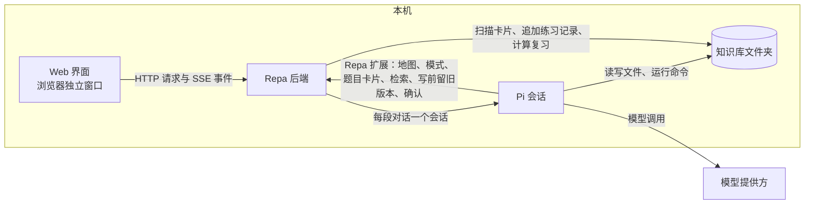

# 自用骨架：文件夹即知识库，每层一段对话

状态：提案

## 问题

转向自用以后，旧主线已经移出，保存在标签 `pre-slim`。维护者要的是一个每天打开就能用的学习助手：学过的东西在一个自己能直接打开书写的知识库里；在某个主题里和 Agent 对话时，不必重新交代背景，也不会被别的主题的细节干扰；Agent 能出题考他，记下考过什么、答得怎样，替他把要长期保持的内容排进复习；需要反复用的能力，Agent 以后能自己写成小工具。

约束已在根目录 [AGENTS.md](../../../../AGENTS.md) 中定下：只在 Linux 上自用，不分发，不兼容旧数据；不设门禁和强制流程；对话在 Repa 自己的网页里进行，界面是一层薄的视图，布局不定死；机制只为实际遇到的问题而加，各部分写明预计行数。

旧主线的后端约 3 万行源码。其中一大块是围绕静态课程的学习插件，转向后不再需要；底座的 1.3 万行里，相当一部分在替 Pi 补它当时不做的事，或防御设想中的故障。按 Pi 1.6.1 核对的结果（见下文“与 Pi 的分界”），会话的保存与续接、压缩、逐层读取项目说明、按段追加的系统提示都已由 Pi 提供，防御在自用下也不再需要。所以本设计的出发点是：Pi 和文件系统已经能做的事直接用，Repa 只写知识库的约定、复习的计算、每一轮交给模型的上下文、题目卡片和界面。

## 做法

### 总览

下图是目标设计。Repa 的后端是本机的一个 Node 进程，界面在浏览器的独立窗口里打开；对话由后端里的 Pi 会话承担，Repa 以一个 Pi 扩展接入会话。



### 知识库是一个文件夹

知识库默认在 `~/Repa`，启动时可以指定别处。文件夹就是层次，Markdown 文件就是卡片，Repa 自己的数据放在 `.repa/` 里：

```text
~/Repa/
  AGENTS.md          对所有学习的要求（可选）
  CSAPP/
    AGENTS.md        对这一层的要求（可选）
    虚拟内存.md      一张卡片
    存储层次.md      一张专题地图页
    第9章/
      页表.md
  论文/
  .agents/skills/    技能，Pi 原生的格式
  .repa/
    log.jsonl        练习记录，只追加
    versions/        Agent 改写前的旧版本
    sessions/        对话，Pi 的格式
    modes/           任务模式
    settings.json    权限开关等设置
```

卡片用任何编辑器都能直接打开书写，写法与 Obsidian 相同：链接写作 `[[页表]]`，可以带显示文字，写作 `[[页表|PT]]`；标题重名时先找同一层的。文件名就是标题。文件头的各项都可以不写：

```markdown
---
id: k7f3qa
summary: 让每个进程以为自己独占连续地址空间的映射机制
keep: true
requires: [页表]
review: 2026-11-29
---

虚拟内存让每个进程以为自己独占一大块连续的地址……

和 [[TLB]] 一起看。
```

| 字段 | 谁写 | 用途 |
| --- | --- | --- |
| `id` | 程序，在这张卡片第一次被练习时写入 | 练习记录指向卡片的依据，卡片改名或移动后记录仍然跟着它 |
| `summary` | Agent 在建立或整理卡片时写，你可以改 | 二三十个字的概括，用于地图和检索；没有时取正文第一行 |
| `keep` | 你，或经你同意的 Agent | 要长期保持：只有保持的卡片才由程序计算复习 |
| `requires` | Agent 整理时提议，你同意后写入 | 先修：不会它们，这张卡片就学不下去 |
| `review` | 你，或照你的话写入的 Agent | 手定的复习日期，到了这一天首页列出这张卡片 |

卡片正文是你的文字：Repa 的程序只写文件头的 `id`，不动正文；Agent 改正文时怎样处理，见下文“Agent 改卡片与运行命令”。

知识之间有三种联系。正文里的 `[[链接]]` 是弱关联，只用于跳转和“链到这里的卡片”；`requires` 是强关联，进入地图；第三种是专题地图页（MOC，map of content），即文件头写着 `moc: true` 的一张普通 Markdown 页，它用链接把别的文件夹里的卡片列进自己所在的这一层，不复制文件。程序只凭 `moc: true` 认出 MOC，普通卡片里的链接不会把别处的卡片拉进本层。MOC 的文件头写 `keep: true` 时，它列出的卡片都算保持。`AGENTS.md` 和 MOC 都不是卡片，不参与练习。

MOC、`requires` 和 `summary` 都可以不写。它们主要由 Agent 在整理时起草，界面把它们显示在卡片旁边，你不需要手工维护。

### 层就是文件夹

每个文件夹是一层，知识库的根是最上层。对话总在某一层里进行：Repa 以这一层的文件夹为工作目录创建 Pi 会话，于是下面三件事由 Pi 直接承担。

- Pi 从文件系统的根逐级读到工作目录，把沿途每个文件夹的 `AGENTS.md` 交给模型（`dist/core/resource-loader.js`）。所以对话读得到这一层和所有上层的要求，读不到兄弟层的。Repa 只把读取的范围限制在知识库之内，免得知识库外层恰好有一份 `AGENTS.md` 混进来；核对时就出现过一次，仓库根目录的 `AGENTS.md` 被读进了测试目录的会话。
- Pi 负责会话的保存、续接和压缩。Repa 把每层的对话存在 `.repa/sessions/` 下按层分开的目录里。
- Agent 的文件工具以这一层为当前目录，相对路径就落在这一层。

你改了某一层的 `AGENTS.md` 以后，从下一条消息起生效：Repa 在发出消息前发现这条链上的文件变了，就让 Pi 重新加载一次。

### 每一轮交给模型的上下文

每次你发出一条消息，Repa 先算出这一层的“地图”，作为几个命名的系统提示段落交给 Pi。Pi 只在段落的文字变了时追加变了的那几段，没变的不重发（`dist/core/system-prompt.js` 的 `diffSystemPromptSections`），提示缓存因此保持有效。地图是对文件、练习记录和复习计算的一次查询，不另存一份：

```text
【位置】知识库 / CSAPP / 第9章（上层：CSAPP 42 张卡片；知识库 130 张）
【这一层】12 张卡片
- 页表：把虚拟页映射到物理页的表
- TLB：页表项的缓存，命中就不必查表
【专题地图页列进来的】存储层次 → 局部性（hot100）：……
【先修】缓存（CSAPP / 第6章）：快忘了
【下一层】9.6 地址翻译（5 张）
【到期的复习】页表（今天）；TLB（逾期 2 天）
【最近没答好的练习】11-25 页表，部分对：漏了多级页表省空间的原因
【知识库的顶层】CSAPP 42 · CS336 18 · 论文 27 · hot100 40
```

在一层里时，地图只投影这一层的卡片、这一层的 MOC 列进来的卡片，以及它们 `requires` 指向的先修，并按复习计算标出其中快要忘的先修；别的领域只出现在最后一行的顶层目录里。需要跨领域时（例如学政治经济学时想到一个算法），Agent 用 `kb_search` 按标题与 `summary` 检索整个知识库，用 `kb_browse` 浏览任一层，再挑着读原文。这沿用了[状态的范围](https://github.com/Utopia-V/Repa/blob/pre-slim/.agents/notes/proposed/architecture/2026-11-15-state-scope.md)提案“摘要是线索，原文按需去取”的做法，不引入向量库。

为了不让地图随知识库一起变大，各项都有上限：这一层的卡片最多列 40 张，超出时列最近改过的 40 张并写明总数；MOC 列进来的与先修合计最多 20 张；下一层最多列 20 个；到期的复习和没答好的练习按这一层及以下统计，练习只列最近 5 次。

地图之外还有一段“模式”。模式是 `.repa/modes/` 里的 Markdown 文件，首次启动时写入三个：讨论学习、抽查复习、整理沉淀，各写几句这种场合下 Agent 该怎样做。对话框顶部可以切换模式，选中的那份作为一个命名段落交给 Pi，切换时 Pi 只追加这一段。你可以修改它们，也可以加新的。

Pi 自带的系统提示把模型定位为编程助手。这一段不能单独删去，所以 Repa 用 Pi 的自定义提示整段换掉它，写明这是你的学习助手，以及文件头的约定、各个工具什么时候用，约 15 行。怎样教你，写在你自己的 `AGENTS.md` 和模式里，由你修改。

### 上下文与会话的管理

对话框顶部显示这段对话已用的上下文占比（Pi 的 `getContextUsage()`），点开能看到注入了什么：读到了哪几份 `AGENTS.md`、当前模式、地图的全文。你可以随时新开一段对话、手动压缩（Pi 的 `compact()`），或切回以前的对话。打开一层时接着这一层最近的对话。

### 练习与复习

Repa 给 Agent 三个练习工具：

| 工具 | 做什么 |
| --- | --- |
| `quiz` | 给出卡片和题目。对话里弹出一张题目卡片，等你作答；题目和作答记入练习记录，作答交回给 Agent。你关掉卡片，或在输入框里直接回话，交回的是“没有作答” |
| `grade` | 记下一次练习的结果（对、部分对、错）、一句讲评，以及可选的外部评测摘要（例如本机测试脚本的输出）。结果显示在题目卡片上，也显示在知识卡片下面。不经题目卡片的练习也用它记，例如你在编辑器里做完的一道代码题 |
| `practice_history` | 取出一张卡片以前的题目、作答和结果。复习时 Agent 用它出题，可以重用旧题，也可以换一道 |

题目用一个很小的 JSON 描述：一道或几道小题，每道是开放作答，或者给出选项的单选。

```json
{"questions":[{"text":"多级页表为什么省空间？"},{"text":"TLB 缓存的是什么？","options":["物理页","页表项","磁盘块"]}]}
```

结果由 Agent 结合整段对话如实判定，程序不另作检测：作答前向 Agent 要过提示的，最多记为部分对；只是问清题干里的一个符号，不受影响。

练习记录是 `.repa/log.jsonl`，一行一个事实，只追加，不改写。每一行都有自己的 `id` 和时间，以后几台设备的记录合并时，按 `id` 去重即可：

```json
{"v":1,"id":"q8x2","t":"2026-11-26T15:02:11+08:00","kind":"quiz","card":"k7f3qa","questions":[{"text":"……"}],"answers":["……"]}
{"v":1,"id":"g3m9","t":"2026-11-26T15:03:40+08:00","kind":"grade","quiz":"q8x2","result":"partial","note":"漏了多级页表省空间的原因"}
```

改记一次结果，就追加一条新的 `grade`，同一次练习以最后一条为准。`v` 是格式版本，格式改变时提高它，旧记录给出明白的拒绝说明。

复习有两个来源。一是程序计算：对保持的卡片，Repa 把它的练习记录交给 `@repa/learning-model` 的 HSRS 公式，算出记忆估计和到期日；对就是一次通过，部分对和错都算失败，部分对扣得少一些，两者都会缩短间隔。二是手定的 `review` 日期，对任何卡片都有效，并优先于计算的结果。首页每天最多列 10 张到期的卡片，只是建议；每张有一个“复习”按钮，它在卡片所在的层新开一段对话，切到“抽查复习”模式，并发出“复习「页表」”，不把昨天的讲解摆在眼前。Agent 用 `practice_history` 出题。考完以后，手定的 `review` 由 Agent 去掉，除非你说了下一次的时间；保持的卡片此后照常由程序计算。

复习的计算是一个可替换的纯函数：输入是卡片（`id`、`keep`、`requires`、`review`）、练习记录和今天的日期，输出是每张卡片的记忆估计和今天的建议。首版的实现只按每张卡片自己的练习记录计算，`requires` 只用于地图，不沿它传递复习信用：旧研究在真实作答上比较过，真实的关系图、随机图和模型画的图对下一次作答的预测几乎相同，现有证据不支持靠关系图减少复习（见标签 `pre-slim` 中学习插件的[参数说明](https://github.com/Utopia-V/Repa/blob/pre-slim/packages/learning/README.md#尚待查证的假设)）。接口仍然接收这张图，以后有了证据再打开传递。练习记录不因换算法而改动，换一种实现，在同一份记录上重算即可。

### Agent 改卡片与运行命令

Agent 用 Pi 的 `write` 或 `edit` 写知识库里已有的文件之前，Repa 的扩展先把原文件复制到 `.repa/versions/<相对路径>/<时间>-<工具调用编号>.md`。Pi 在工具运行之前依次等待这类处理完成，所以复制总在改写之前。对话里每次改动显示为一行：`edit` 按它的参数并排显示原文与新文，`write` 显示“整篇改写”。每行都有“撤回”，把文件恢复成改动前的版本；撤回之前，当前内容同样留一份，所以撤回本身也能撤回。

改卡片和运行命令各有一个开关，在对话框顶部，存在 `.repa/settings.json`。默认都是直接执行；打开以后，Agent 每次改卡片或运行命令之前，对话里先出现一张确认卡片，你同意才执行，不同意就把你的理由交回给 Agent。这与编码 Agent 的做法相同，用的也是改写前那一处钩子。

你在 Repa 的编辑器里保存卡片时不留旧版本，与普通编辑器一样。保存时如果文件在你打开以后被 Agent 或别的编辑器改过，Repa 不覆盖，而是提示你先看最新内容，你正在写的文字和 Agent 的改动都不会悄悄丢掉。

### 小工具：首版不做

目标不变：Agent 写一个小工具，当场加载，出错后自己修改，不用重开会话就能调用。具体格式暂不定，以后参考 DeepSeek Harness 的做法再设计。已核对的事实留作依据：Pi 1.6.1 在运行中调用 `reload()` 会直接报错（`dist/core/agent-session.js`），但允许运行中注册新工具，下一步模型就能看到它。

技能放在知识库的 `.agents/skills/`。Pi 从工作目录逐级向上查找技能时会找到它们，不需要 Repa 的代码。

### 界面

界面是一层薄的视图。它复用 `apps/web/src/components/ui` 中的基础组件、`globals.css` 中的设计 token，以及含代码高亮与公式的 Markdown 渲染；旧的页面和对话组件绑在旧协议上，不再沿用。首版的排列只是起点，用几天以后按手感调整：左边是“今日”和文件夹树，中间是文件夹或卡片，右边是当前层的对话。

- **今日：** 到期的卡片，以及最近用过的几层。
- **文件夹：** 这一层的 `AGENTS.md`（可以直接编辑）、MOC、卡片列表和下一层；可以新建卡片和文件夹。
- **卡片：** 渲染后的正文；“编辑”切换为 Markdown 原文；`summary`、保持、先修和复习日期；链到这里的卡片；最下面是这张卡片的练习记录。
- **对话：** 顶部是上下文占比、模式、两个权限开关和模型选择；中间是消息、题目卡片、确认卡片、改动与撤回；可以停止、新开、压缩、翻回以前的对话。

`[[链接]]` 在卡片正文和 Agent 的回复里都能点：点开的卡片显示在中间，对话不动，正在进行的讨论不受打断。只有在文件夹树里点进另一层时，对话才切到那一层。

以下留到以后，首版不做：悬停预览，界面里改名、移动和删除卡片，快捷搜索，按状态与脉络归类的卡片墙，PDF 预览。

### 后端与启动

后端用 Node 自带的 `http` 模块，只监听 `127.0.0.1`。请求和回应是 JSON，对话的事件用 SSE 推给界面。后端把 Pi 的事件换成界面用的几种（文字增量、工具开始与结束、待作答或待确认、一次运行结束、出错），界面因此不依赖 Pi 的类型。

| 接口 | 用途 |
| --- | --- |
| `GET /api/tree`、`GET /api/folder`、`GET /api/card` | 文件夹树、一层的概况、一张卡片及其练习记录 |
| `PUT /api/card`、`POST /api/folder` | 保存或新建卡片，新建文件夹。保存时带着打开时的修改时间，文件已被改过就拒绝 |
| `GET /api/today` | 今天的复习建议与最近用过的层 |
| `GET /api/sessions`、`POST /api/sessions` | 一层的对话列表；打开或新建一段对话 |
| `POST /api/sessions/:id/prompt`、`/abort`、`/compact`、`/model`、`/mode` | 发消息、停止、压缩、换模型、换模式 |
| `GET /api/sessions/:id/events`、`GET /api/sessions/:id/context` | 这段对话的历史与事件流（SSE）；上下文占比与注入的内容 |
| `POST /api/pending/:toolCallId` | 交上题目卡片的作答，或回应一张确认卡片 |
| `POST /api/revert` | 撤回一次改动 |
| `GET /api/models`、`PUT /api/settings` | 有凭据的模型；权限开关 |

Agent 能运行命令，所以后端只接受来自自己页面的请求：`Host` 必须是本机地址加端口；请求带 `Origin` 时，必须与它相同；写入类请求必须是 JSON。这样，别的网页无法借你的浏览器驱动 Agent，也无法用 DNS 重绑定绕过本机地址的限制。

启动用一个 `repa` 命令：后端没在运行就在后台启动它，然后用 Edge 的应用模式（`microsoft-edge --app=…`）打开窗口；另装一个桌面图标调用这个命令。模型与登录沿用 Pi：凭据在 `~/.pi/agent/auth.json`，用 `pi auth login` 登录 Claude 或 ChatGPT 的订阅，或者填 API key；界面只列出已有凭据的模型。

### 与 Pi 的分界

| 由 Pi 承担 | 由 Repa 编写 |
| --- | --- |
| 模型调用与登录、工具循环、文件与命令工具 | 知识库的约定：卡片、文件头、MOC、链接 |
| 会话的保存、续接、压缩与上下文占比 | 复习的计算：适配 `learning-model` 的纯函数 |
| 逐层读取 `AGENTS.md`，技能的发现 | 每层的地图与模式，作为命名段落交给 Pi |
| 改写前的钩子，系统提示的分段与按段追加 | 题目卡片、练习记录与检索：`quiz`、`grade`、`practice_history`、`kb_search`、`kb_browse` |
| | 写前留旧版本与撤回，确认开关；后端接口、事件转换、界面与启动 |

Repa 的持久数据是卡片、`log.jsonl`、`versions/`、`modes/` 和 `settings.json`，其中没有 Pi 的类型和概念。对话以 Pi 的格式存在 `.repa/sessions/`；以后换掉 Pi 时，旧对话不再转换，学习状态不受影响，因为它从不只存在于对话里。

以上 Pi 的行为都在 `@earendil-works/pi-coding-agent` 1.6.1 的源码中核对过，其中逐层读取 `AGENTS.md`、运行中注册工具、按段追加、改写前的钩子、会话的续接和换模型还用 Pi 自带的离线测试模型实际运行过。依赖锁定在 1.6.1，并且 `@earendil-works/*` 各包必须同一版本：1.1.0 曾因安装时拉到不同版本的兄弟包，在导入时崩溃。

### 仓库的变化

- 新增 `packages/repa`，即后端与 Repa 扩展。
- 保留 `packages/learning-model`，复习的计算经一个薄的适配层调用它。
- `apps/web` 换成新的页面，只留 `components/ui`、`globals.css`、Markdown 渲染及它们用到的工具函数，重新加入构建、lint 和测试。
- 删去[知识库](https://github.com/Utopia-V/Repa/blob/pre-slim/.agents/notes/proposed/architecture/2026-11-11-knowledge-base.md)、[状态的范围](https://github.com/Utopia-V/Repa/blob/pre-slim/.agents/notes/proposed/architecture/2026-11-15-state-scope.md)与[题目结构](https://github.com/Utopia-V/Repa/blob/pre-slim/.agents/notes/proposed/architecture/2026-11-02-item-structure.md)三份提案。它们按课程组织学习，与转向后的方向不再相符；本设计沿用了其中的这些做法：卡片是学习者的文件，改名、移动不丢记录；有卡片不等于要学；先修只写确实离不开的；摘要是对事实的查询，不另存一份；默认隔离，原文按需去取。

## 默认行为

以下默认做法学习者都能感知，维护者此前没有逐条确认过；审阅时不同意的划掉即可。

1. 知识库默认在 `~/Repa`。
2. 打开一层时接着这一层最近的对话；“复习”在那一层新开一段对话，并切到“抽查复习”模式。新对话默认是“讨论学习”模式。
3. 除 `AGENTS.md`、MOC 和以点开头的文件夹外，每个 Markdown 文件都是卡片。文件夹里的 PDF 等资料在树里列出，Agent 可以读，界面不预览。
4. 文件头的 `id` 由程序在第一次练习时写入；`summary` 由 Agent 写；`keep`、`requires` 由 Agent 提议、你同意后写入。
5. 只有保持的卡片由程序计算复习；手定的 `review` 对任何卡片都有效，并优先于计算的结果。
6. 保持的卡片若从没答对过，一直列在建议里，直到有一次答对。
7. 部分对与错都缩短复习间隔；要过提示的作答最多记为部分对，由 Agent 判定。
8. 复习的计算不沿 `requires` 传递信用。
9. 首页每天最多列 10 张到期的卡片，没有每日目标、XP、连续天数或统计。
10. 复习完一张卡片，Agent 去掉手定的 `review`，除非你说了下一次的时间。
11. 题目卡片可以不答直接关掉，记为“没有作答”，此外什么也不发生。
12. Agent 改卡片前留旧版本，改动可以撤回；改卡片与运行命令默认不需要确认，各有一个开关可以改为先确认。
13. 你在 Repa 里保存时，文件若已被别处改过，先让你看最新内容。
14. 链接打开的卡片显示在中间，对话不动；只有在文件夹树里点进一层，对话才切换。
15. 在界面里换的模型同时成为以后新对话的默认模型。
16. 登录用 Pi 的命令行，Repa 不做登录页。
17. 用 Edge 的应用模式打开窗口；任何浏览器的标签页也都能用。
18. 地图里各项的上限：这一层的卡片 40 张、MOC 列进来的与先修合计 20 张、下一层 20 个、没答好的练习 5 次。

## 刻意不做

- 评定掌握程度、XP、测验、每日目标、学新内容的排程。
- 任何门禁和强制流程。
- 程序检测作答时是否看过提示或卡片。
- 沿关系图传递复习信用。
- 影子 Git、锁、备份、恢复与导出。知识库就是一个文件夹，备份就是复制它，也可以自己放进 git。
- 沙箱和小工具的隔离。
- 桌面通知、桌面壳、安装包、Windows 与 macOS。
- MCP 与子代理。Pi 都有现成的扩展，用到时再接。
- 向量检索。
- 首版不做小工具，也不做悬停预览、界面里改名移动删除、快捷搜索、卡片墙和 PDF 预览。
- 清理旧版本；为命令行里写的文件留旧版本。

## 体量预算

| 部分 | 预计行数 |
| --- | --- |
| 知识库：扫描、文件头、MOC、链接、保存与撤回 | 260 |
| 练习记录 | 60 |
| 复习的计算：纯函数接口与 `learning-model` 的适配 | 100 |
| 地图与模式 | 160 |
| Repa 扩展：五个工具、自定义提示、写前留旧版本、确认 | 260 |
| 会话：每层的 Pi 会话、模型、上下文、事件转换、重新加载 | 200 |
| 后端接口、SSE、请求来源检查、静态文件 | 230 |
| `repa` 命令与桌面图标 | 50 |
| 后端合计 | 约 1,300 |
| 界面：外框、文件夹树、文件夹与卡片、编辑、对话、题目卡片、确认卡片、改动与撤回、上下文面板、今日、模型与模式 | 约 1,800 |
| 测试 | 约 800 |

某一部分写到超出预计一半时，停下来重新想它的结构，不继续往上补。

## 考虑过的其他做法

**在旧底座上做减法。** 旧底座的空间、历史、锁、协议与插件加载彼此牵连，减到能用比重写这一千多行更费力；需要的零件仍可从标签 `pre-slim` 取回。

**对话放在终端的 Claude Code 里，Repa 只提供命令。** 维护者选了 Repa 自己的网页，让知识库、今日和对话在同一个界面里。本设计的状态都是文件，以后要从 Claude Code 接入，再加一个命令行入口即可。

**用标签或配置划分层，而不用文件夹。** 文件夹看得见，用任何工具都能整理；Pi 逐级读取 `AGENTS.md`、Agent 的当前目录也都以文件夹为单位。用标签就要另写一套范围引擎。文件夹只给出默认的归属，跨层的视野由 MOC 和 `requires` 补上。

**凭正文里的链接把卡片拉进本层。** 正文链接多是顺手的引用，凭它投影会把无关的卡片塞进地图，所以只认 `moc: true` 的页面和 `requires`。

**题目写进卡片正文。** 卡片正文是你的文字，题目和作答越积越多会把它淹没。放在只追加的练习记录里，还能按卡片、按层查询；界面上它们仍然显示在卡片下面。

**所有卡片都进复习。** hot100 按 3 天、7 天重做没答好的题，结果复习越滚越多，挤掉了别的学习。所以只有保持的卡片进入计算，首页的建议有上限。

**程序检测是否看过提示。** 这需要给每道题加提示字段和按钮，还会把澄清题干误判为求助；Agent 本来就读得到整段对话，判定时据实记下即可。

**向量检索。** 卡片的标题和二三十字的 `summary` 已经足够让模型挑选；向量库要另建索引并随卡片更新，等按摘要检索确实不够用时再说。

**Electron 桌面壳。** 旧桌面端的 1,800 行大部分在处理打包和分发。只在本机使用时，浏览器的应用模式已经是独立窗口，不需要壳。

**界面直接使用 Pi 的事件，或 Pi 的 Web 组件。** `pi-web-ui` 停在 0.75 版，只能渲染运行在浏览器里的 Agent；`pi-server` 与 `pi-client` 停在 1.1.0。界面直接使用 Pi 的事件，会把 Pi 的类型带进界面，换 Pi 时就要改界面；由后端转换只需几十行。

**Pi 组织的 Chord。** 它是一套跨进程的应用运行时，带存储、可热加载的插件、Web 与终端界面和实验性的同步，与 Pi 一起发布到 1.6.1。它的概念（契约、facet、宿主、文档、事务）比本设计的整个后端还大。以后做电脑、云端与手机之间的同步时，再评估它。

## 验收

1. 双击桌面图标，独立窗口打开，看到知识库的文件夹和卡片。
2. 在 CSAPP 里问一个问题，让 Agent 整理成卡片，卡片出现在 CSAPP 下，带着 `summary`。你改写正文后让它补一个例子，它的改动在对话里可见、可以撤回，你写的段落保持原样。
3. 让 Agent 考你：对话里出现题目卡片，有开放题也有单选题；你作答，它讲评；卡片下面能看到题目、你的回答和结果。
4. 把这张卡片设为保持：之后它按练习结果出现在首页的建议里；点“复习”，在一段新对话里，Agent 参考上次的题目和结果考你。告诉 Agent 某一天复习另一张没有保持的卡片，那天它也出现在首页。
5. 第二天打开 CSAPP，接着昨天的对话，不必重新交代背景；Agent 知道这一层有哪些卡片、昨天哪里没答好、哪个先修快忘了。在论文那一层对话时，它不知道 CSAPP 的细节；你提到相关的概念时，它能检索到 CSAPP 里的卡片并读出来。
6. 打开“运行命令先确认”，Agent 要运行命令时出现确认卡片；拒绝以后，它照你的理由换一种做法。
7. 对话顶部看得到上下文的占比和注入的内容；手动压缩以后，占比下降，对话照常继续。
8. Agent 回复里的 `[[链接]]` 能点开卡片，对话不动。
9. 在 VS Code 或 Obsidian 里改卡片，回到 Repa 后看到的是改过的内容。

## 风险与代价

- **对话的格式属于 Pi。** 换掉 Pi 时旧对话不再转换。卡片、练习记录和旧版本都是 Repa 自己的格式，不受影响。
- **HSRS 的参数是假设。** `learning-model` 的常数多数是 Repa 的猜测，间隔可能过密或过疏；手定的 `review` 可以随时纠正，参数等有了足够的练习记录再校准。
- **结果由模型判定。** 判宽或判严都会影响复习的间隔；讲评和结果都显示在卡片下面，你看得到，不对可以让 Agent 改记。
- **提示缓存。** 切换模式、重新加载以后，部分提供方的缓存会失效一次；地图的段落变化只追加变了的那段。
- **Agent 可能写坏文件头。** 这张卡片的复习或记录因此读不出来；界面把它标为出错，撤回即可恢复。
- **默认不确认时，Agent 能做你在终端里能做的任何事。** 包括删除文件；命令行写的文件不留旧版本。需要时打开确认开关。
- **本机的其他程序能调用后端。** 请求来源的检查只挡住网页；这台机器只有你使用，不另设令牌。
- **依赖 Edge 的应用模式。** 只影响窗口的样子，任何浏览器的标签页都能用。
