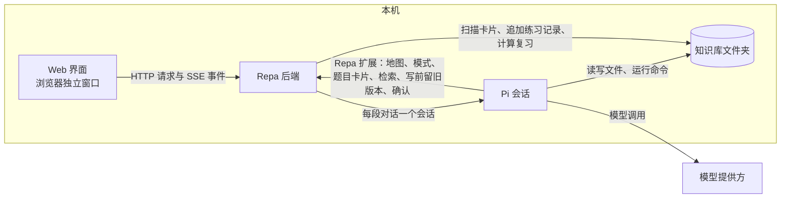

# 自用骨架：文件夹即知识库，每层一段对话

状态：提案

后端已在 `packages/repa` 实现，界面待定。

## 问题

转向自用以后，旧主线已经移出，保存在标签 `pre-slim`。维护者要的是一个每天打开就能用的学习助手：学过的东西在一个自己能直接打开书写的知识库里；在某个主题里和 Agent 对话时，不必重新交代背景，也不会被别的主题的细节干扰；Agent 能出题考他，记下考过什么、答得怎样，替他把要长期保持的内容排进复习；需要反复用的能力，Agent 以后能自己写成小工具。

约束已在根目录 [AGENTS.md](../../../../AGENTS.md) 中定下：只在 Linux 上自用，不分发，不兼容旧数据；不设门禁和强制流程；对话在 Repa 自己的网页里进行，界面是一层薄的视图，布局不定死；机制只为实际遇到的问题而加，各部分写明预计行数。

旧主线的后端约 3 万行源码。其中一大块是围绕静态课程的学习插件，转向后不再需要；底座的 1.3 万行里，相当一部分在替 Pi 补它当时不做的事，或防御设想中的故障。按 Pi 1.6.1 核对的结果（见下文“与 Pi 的分界”），会话的保存与续接、压缩、逐层读取项目说明、按段追加的系统提示都已由 Pi 提供，防御在自用下也不再需要。所以本设计的出发点是：Pi 和文件系统已经能做的事直接用，Repa 只写知识库的约定、复习的计算、每一轮交给模型的上下文、题目卡片和界面。

## 做法

### 总览

下图是目标设计。Repa 的后端是本机的一个 Node 进程，界面在浏览器的独立窗口里打开；对话由后端里的 Pi 会话承担，Repa 以一个 Pi 扩展接入会话。



### 知识库是一个文件夹

知识库默认在 `~/Repa`，启动时可以指定别处。文件夹就是层次，Markdown 文件就是卡片，Repa 自己的数据放在 `.repa/` 里：

```text
~/Repa/
  AGENTS.md          对所有学习的要求（可选）
  CSAPP/
    AGENTS.md        对这一层的要求（可选）
    虚拟内存.md      一张卡片
    存储层次.md      一张专题地图页
    第9章/
      页表.md
    _资料/           讲义、转写稿、作业仓库：不是卡片，也不成层
  论文/
  .agents/skills/    技能，Pi 原生的格式
  .repa/
    log.jsonl        练习记录，只追加
    versions/        Agent 改写前的旧版本
    sessions/        学习对话，Pi 的格式
    reviews/         复习对话，Pi 的格式
    modes/           任务模式
    settings.json    权限开关等设置
```

卡片用任何编辑器都能直接打开书写，写法与 Obsidian 相同：链接写作 `[[页表]]`，可以带显示文字，写作 `[[页表|PT]]`；标题重名时先找同一层的。文件名就是标题。文件头的各项都可以不写：

```markdown
---
id: k7f3qa9d
summary: 让每个进程以为自己独占连续地址空间的映射机制
keep: true
requires: [页表]
review: 2026-11-29
---

虚拟内存让每个进程以为自己独占一大块连续的地址……

和 [[TLB]] 一起看。
```

| 字段 | 谁写 | 用途 |
| --- | --- | --- |
| `id` | 程序，在这张卡片第一次被练习时写入，8 位随机字符 | 练习记录指向卡片的依据，卡片改名或移动后记录仍然跟着它 |
| `summary` | Agent 在建立或整理卡片时写，你可以改 | 二三十个字的概括，用于地图和检索；没有时取正文第一行 |
| `keep` | 你，或经你同意的 Agent | 要长期保持：只有保持的卡片才由程序计算复习。写 `false` 可以让这张卡片退出 MOC 带来的保持 |
| `requires` | Agent 整理时提议，你同意后写入 | 先修：不会它们，这张卡片就学不下去 |
| `review` | 你，或照你的话写入的 Agent | 手定的复习日期，到了这一天首页列出这张卡片；这一天或之后有了一次判定过的练习，这个日期就不再起作用 |

卡片正文是你的文字：Repa 的程序只写文件头的 `id`，不动正文；Agent 改正文时怎样处理，见下文“Agent 改卡片与运行命令”。`id` 归程序所有：Agent 的一次改写若把它丢了或改了，程序在改写完成后把它写回，练习记录不会因此悄悄断开。

知识之间有三种联系。正文里的 `[[链接]]` 是弱关联，只用于跳转和“链到这里的卡片”；`requires` 是强关联，进入地图；第三种是专题地图页（MOC，map of content），即文件头写着 `moc: true` 的一张普通 Markdown 页，它用链接把别的文件夹里的卡片列进自己所在的这一层，不复制文件。程序只凭 `moc: true` 认出 MOC，普通卡片里的链接不会把别处的卡片拉进本层。MOC 的文件头写 `keep: true` 时，它列出的卡片都算保持，卡片自己写了 `keep: false` 的除外，做熟的内容因此可以单独退出。`AGENTS.md` 和 MOC 都不是卡片，不参与练习。

链接按标题找卡片，所以卡片改名以后，指向旧标题的链接就找不到目标。界面把这样的链接标出来，`requires` 和 MOC 里的也一样，免得一张卡片因为改名悄悄退出某个 MOC 的保持。

MOC、`requires` 和 `summary` 都可以不写。它们主要由 Agent 在整理时起草，界面把它们显示在卡片旁边，你不需要手工维护。

讲义、转写稿、作业仓库这类资料也可以放在层里，但它们不是卡片。名字以 `_` 开头的文件夹（例如 `_资料`）、名为 `node_modules` 的文件夹，以及含 `.git` 的文件夹（克隆下来的仓库），和以点开头的文件夹一样不扫描：里面的 Markdown 不算卡片，文件夹本身也不成为一层，不进地图、张数和检索。`_` 开头的文件夹和仓库仍在文件夹树里列出，Agent 照常能读。知识库的根不受“含 `.git`”这一条约束，所以整个知识库可以放进 git。

### 层就是文件夹

每个文件夹是一层，知识库的根是最上层。对话总在某一层里进行：Repa 以这一层的文件夹为工作目录创建 Pi 会话，于是下面三件事由 Pi 直接承担。

- Pi 从文件系统的根逐级读到工作目录，把沿途每个文件夹的 `AGENTS.md` 交给模型（`dist/core/resource-loader.js`）。所以对话读得到这一层和所有上层的要求，读不到兄弟层的。Repa 只把读取的范围限制在知识库之内，免得知识库外层恰好有一份 `AGENTS.md` 混进来；核对时就出现过一次，仓库根目录的 `AGENTS.md` 被读进了测试目录的会话。Pi 还会先读它的全局目录 `~/.pi/agent/` 里的 `AGENTS.md`，这一份也一并排除。
- Pi 负责会话的保存、续接和压缩。Repa 把每层的学习对话存在 `.repa/sessions/` 下按层分开的目录里，复习对话另存在 `.repa/reviews/`。
- Agent 的文件工具以这一层为当前目录，相对路径就落在这一层。

你改了某一层的 `AGENTS.md` 以后，从下一条消息起生效：Repa 在发出消息前发现这条链上的文件变了，就让 Pi 重新加载一次。

### 每一轮交给模型的上下文

每次你发出一条消息，Repa 先算出这一层的“地图”，作为几个命名的系统提示段落交给 Pi。Pi 只在段落的文字变了时追加变了的那几段，没变的不重发（`dist/core/system-prompt.js` 的 `diffSystemPromptSections`），提示缓存因此保持有效。地图是对文件、练习记录和复习计算的一次查询，不另存一份：

```text
【位置】知识库 / CSAPP / 第9章（上层：CSAPP 42 张卡片；知识库 130 张）
【这一层】12 张卡片
- 页表：把虚拟页映射到物理页的表
- TLB：页表项的缓存，命中就不必查表
【专题地图页列进来的】存储层次 → 局部性（hot100）：……
【先修】缓存（CSAPP / 第6章）：快忘了
【下一层】9.6 地址翻译（5 张）
【到期的复习】页表（今天）；TLB（逾期 2 天）
【最近没答好的练习】11-25 页表，部分对：漏了多级页表省空间的原因
【知识库的顶层】CSAPP 42 · CS336 18 · 论文 27 · hot100 40
```

在一层里时，地图只投影这一层的卡片、这一层的 MOC 列进来的卡片，以及它们 `requires` 指向的先修，并按复习计算标出其中快要忘的先修；别的领域只出现在最后一行的顶层目录里。需要跨领域时（例如学政治经济学时想到一个算法），Agent 用 `kb_search` 按标题与 `summary` 检索整个知识库，用 `kb_browse` 浏览任一层，再挑着读原文。这沿用了[状态的范围](https://github.com/Utopia-V/Repa/blob/pre-slim/.agents/notes/proposed/architecture/2026-11-15-state-scope.md)提案“摘要是线索，原文按需去取”的做法，不引入向量库。

为了不让地图随知识库一起变大，各项都有上限：这一层的卡片最多列 40 张，超出时列最近改过的 40 张并写明总数；MOC 列进来的与先修合计最多 20 张；下一层最多列 20 个；到期的复习和没答好的练习按这一层及以下统计，练习只列最近 5 次。

地图之外还有一段“模式”。模式是 `.repa/modes/` 里的 Markdown 文件，首次启动时写入三个：讨论学习、抽查复习、整理沉淀，各写几句这种场合下 Agent 该怎样做。对话框顶部可以切换模式，选中的那份作为一个命名段落交给 Pi，切换时 Pi 只追加这一段。你可以修改它们，也可以加新的。

Pi 自带的系统提示把模型定位为编程助手。这一段不能单独删去，所以 Repa 用 Pi 的自定义提示整段换掉它，写明这是你的学习助手，以及文件头的约定、资料放在哪类文件夹里、各个工具什么时候用，约 15 行。怎样教你，写在你自己的 `AGENTS.md` 和模式里，由你修改。

地图和模式说的是这一层，另有两样东西只跟着单条消息走。一是你正在看的卡片：每条消息带一行它的路径，你可以直接说“这里第二段没看懂”，不必报出卡片的名字。二是复习一张卡片时的材料，见下文“练习与复习”。Repa 把它们作为附带的上下文交给模型，不显示在对话正文里；Pi 允许扩展在一轮开始前插入一条不显示的消息（`before_agent_start` 返回的 `message`），这里用的就是它。

### 上下文与会话的管理

对话框顶部写着这段对话所在的层，并显示已用的上下文占比（Pi 的 `getContextUsage()`），点开能看到注入了什么：读到了哪几份 `AGENTS.md`、当前模式、地图的全文，以及随消息附带的上下文。你可以随时新开一段对话、手动压缩（Pi 的 `compact()`），或切回以前的对话。

浏览和对话是分开的。你在文件夹树里点开别的文件夹、别的卡片，只是换了中间显示的内容，对话留在原来的文件夹。正在看的文件夹与对话所在的不同时，对话顶部的文件夹名旁边出现一个按钮，写着正在看的那个文件夹，点了才把对话换过去，接着那里最近的一段学习对话。新对话开在正在看的文件夹；正在看“今日”或知识库时，开在知识库的根上。切走以后，原来那段对话还没说完的回复继续进行，切回去能看到；它若有题目或确认在等，左栏里那一项带一个点。

### 练习与复习

Repa 给 Agent 三个练习工具：

| 工具 | 做什么 |
| --- | --- |
| `quiz` | 给出题目和所考的卡片，卡片可以不给。对话里弹出一张题目卡片，等你作答；题目和作答记入练习记录，作答交回给 Agent。你关掉卡片，或在输入框里直接回话，交回的是“没有作答” |
| `grade` | 记下一次练习的结果（对、部分对、错）、一句讲评，以及可选的外部评测摘要（例如本机测试脚本的输出）。结果显示在题目卡片上，也显示在知识卡片下面。不经题目卡片的练习也用它记，这时要给出卡片，例如你在编辑器里做完的一道代码题 |
| `practice_history` | 取出一张卡片以前的题目、作答和结果。Agent 出题前用它查旧题，可以重用，也可以换一道 |

题目用一个很小的 JSON 描述：一道或几道小题，每道是开放作答，或者给出选项的单选。

```json
{"questions":[{"text":"多级页表为什么省空间？"},{"text":"TLB 缓存的是什么？","options":["物理页","页表项","磁盘块"]}]}
```

结果由 Agent 结合整段对话如实判定，程序不另作检测：作答前向 Agent 要过提示的，最多记为部分对；只是问清题干里的一个符号，不受影响。

讨论中 Agent 想考一个还没有卡片的概念时，`quiz` 可以不指定卡片，知识库还空的头几天尤其用得上。这样的练习照常记录，并记下出题时所在的层，地图里“最近没答好的练习”因此列得出它；它不属于任何卡片，不参与复习。

练习记录是 `.repa/log.jsonl`，一行一个事实，只追加，不改写。每一行都有自己的 `id` 和时间。`id` 由毫秒时间和 4 位随机字符组成，几台设备各自生成，重号的可能也可以忽略，以后合并记录时按 `id` 去重即可。下面四行依次是一次指定了卡片的出题、它的判定、一次不经题目卡片的练习，以及一次没有指定卡片的出题：

```json
{"v":1,"id":"mwx7fyuw3k9q","t":"2026-11-26T15:02:11+08:00","kind":"quiz","card":"k7f3qa9d","questions":[{"text":"……"}],"answers":["……"]}
{"v":1,"id":"mwx7hvj4x2ap","t":"2026-11-26T15:03:40+08:00","kind":"grade","quiz":"mwx7fyuw3k9q","result":"partial","note":"漏了多级页表省空间的原因"}
{"v":1,"id":"mwxa85c8r7d1","t":"2026-11-26T16:20:05+08:00","kind":"grade","card":"p2m8xw4c","result":"pass","note":"接雨水：双指针一次写对"}
{"v":1,"id":"mwxa9dbkt5e0","t":"2026-11-26T16:21:02+08:00","kind":"quiz","folder":"CSAPP/第9章","questions":[{"text":"……"}],"answers":["……"]}
```

改记一次结果，就追加一条新的 `grade`，同一次练习以最后一条为准。`v` 是格式版本，格式改变时提高它，旧记录给出明白的拒绝说明。

复习有两个来源。一是程序计算：对保持的卡片，Repa 把它的练习记录交给 `@repa/learning-model` 的 HSRS 公式，算出记忆估计和到期日；对就是一次通过，部分对和错都算失败，部分对按一半扣，两者都会缩短间隔。二是手定的 `review` 日期，对任何卡片都有效，并优先于计算的结果。手定的复习是否完成也由程序判断：这个日期当天或之后，这张卡片有了一次判定过的练习，就算完成，日期留在文件头里不再起作用；你说了下一次的时间，Agent 才去改它。

计算按天进行。练习的时间换算成你本地的日历日，凌晨 4 点换日，所以夜里 23 点复习过的卡片第二天一早就可以到期，凌晨 4 点以前的练习仍算在前一天。同一天里同一张卡片练了几次，只算一次，取其中最差的结果：答错以后听完讲解再答对，考到的是刚看过的内容，所以这张卡片第二天仍回到建议里，隔了一夜再答对才算数。今天练过的卡片，今天不再列出。

这样使用之前，`learning-model` 的失败更新式要改一处。它给提前的复习打折，这个折扣同样乘在失败上，memory 的扣减又与 `1 - memory` 成比例，所以刚复习过的卡片答错几乎没有影响：按默认常数，一张间隔 24 天的卡片在通过后的第二天答错，间隔只从 24.3 天变为 23.0 天，memory 仍是 0.97。旧主线的选择器只给出到期的复习，这个问题不显眼；现在 Agent 随时会在对话里出题。改法是失败不再打提前折扣，memory 按这次失败的分量成比例扣减，答错归零，部分对减半。同一个例子里，答错以后间隔退到 9 天，部分对退到 15 天。在到期线上，新旧两式的结果相同；改动以后，无论什么时候答错或部分对，这张卡片都从第二天起回到建议里，直到答对。

首页的建议最多 10 张，只是建议。次序是：手定日期已到的在最前；然后是到期的，记忆估计最低的排在前面；最后是标了保持却还没有答对过的。最后这一类单独成组，免得给一个 MOC 写上 `keep: true` 以后，几十张新卡片把真正快忘的内容挤出去。两组都写明总数，例如“到期 8 / 37”。

每张建议的卡片有一个“复习”按钮。它新开一段复习对话，以卡片所在的层为工作目录，用“抽查复习”模式，并发出“复习「页表」”。卡片的正文和最近几次练习由程序附在这条消息里交给模型，所以 Agent 的第一次回复就是题目，不必先花两轮去读卡片、查记录。复习对话与学习对话分开存放：它不算这一层“最近的对话”，在对话列表里折成一组，复习过后再回到这一层，接上的仍是原来的讨论。复习时中间一栏停在“今日”，不把卡片的正文摆在题目旁边；你想看卡片，点开就是，没有限制。在学习对话里临时想考以前的内容时，Agent 用 `practice_history` 取旧题。

复习的计算是一个可替换的纯函数：输入是卡片（`id`、`keep`、`requires`、`review`）、练习记录和今天的日期，输出是每张卡片的记忆估计和今天的建议。首版的实现只按每张卡片自己的练习记录计算，`requires` 只用于地图，不沿它传递复习信用：旧研究在真实作答上比较过，真实的关系图、随机图和模型画的图对下一次作答的预测几乎相同，现有证据不支持靠关系图减少复习（见标签 `pre-slim` 中学习插件的[参数说明](https://github.com/Utopia-V/Repa/blob/pre-slim/packages/learning/README.md#尚待查证的假设)）。接口仍然接收这张图，以后有了证据再打开传递。练习记录不因换算法而改动，换一种实现，在同一份记录上重算即可。

### Agent 改卡片与运行命令

Agent 用 Pi 的 `write` 或 `edit` 写知识库里已有的文件之前，Repa 的扩展先把原文件复制到 `.repa/versions/<相对路径>/<时间>-<工具调用编号>.md`。Pi 在工具运行之前依次等待这类处理完成，所以复制总在改写之前。对话里每次改动显示为一行，点开是旧版本与改写后的文件逐行比较的差异；`edit` 和 `write` 都这样显示，整篇改写时也看得出你写的段落是否还在。每行都有“撤回”，把整个文件恢复成这次改动之前的版本，这次之后对同一文件的改动也随之退掉；撤回一次新建，就是删除这个文件。撤回之前，当前内容同样留一份，所以撤回本身也能撤回。

Agent 用 `write` 整篇写入一个已有的文件之前，必须读过它当前的内容：扩展记下 Agent 上次读到或写下每个文件时的修改时间，与文件现在的不同，这次写入就被拦下，理由交回给 Agent，它读过以后再写。这一条来自实现后的走查：学习者在编辑器里给卡片补了两行，Agent 随后凭对话里的旧印象整篇改写，那两行被悄悄盖掉，只有旧版本里还留着。`edit` 不受这条约束，因为它要求被替换的原文逐字存在，原文变了就会失败。代价是 Agent 在你改过文件以后要多读一次，后端重启以后也要先读再写。

改卡片和运行命令各有一个开关，在对话框顶部，存在 `.repa/settings.json`。默认都是直接执行；打开以后，Agent 每次改卡片或运行命令之前，对话里先出现一张确认卡片，你同意才执行，不同意就把你的理由交回给 Agent。这与编码 Agent 的做法相同，用的也是改写前那一处钩子。

你在 Repa 的编辑器里保存卡片时不留旧版本，与普通编辑器一样。保存时如果文件在你打开以后被 Agent 或别的编辑器改过，Repa 不覆盖，而是提示你先看最新内容，你正在写的文字和 Agent 的改动都不会悄悄丢掉。

### 小工具：首版不做

目标不变：Agent 写一个小工具，当场加载，出错后自己修改，不用重开会话就能调用。具体格式暂不定，以后参考 DeepSeek Harness 的做法再设计。已核对的事实留作依据：Pi 1.6.1 在运行中调用 `reload()` 会直接报错（`dist/core/agent-session.js`），但允许运行中注册新工具，下一步模型就能看到它。

技能放在知识库的 `.agents/skills/`。Pi 从工作目录逐级向上查找技能时会找到它们，不需要 Repa 的代码。

### 界面

界面是一层薄的视图。它的外观和每个部件都由维护者看过画稿以后定下，亮色与暗色各一套。旧的 `apps/web/src/components/ui` 不再沿用：它连同配套的工具有七千多行，是整个界面的两倍，带的又是已经否定的外观，而外观写在组件的结构里，改设计 token 换不掉。新界面从旧代码留下三样：Base UI，作为对话框、菜单、开关这类部件的焦点与键盘行为的依赖；基础部件里的几条行为，即输入法下的回车、Esc 逐层退出、失败时保留输入、焦点归还和减弱动效；含代码高亮与公式的 Markdown 渲染。部件只写下面这些画面用到的，不另做一套组件库。

**壳。** 窗口分三块：可折叠的左栏、中间的一页、右侧可开合的对话面板。中间一次只显示一样东西：今日、知识库、某个文件夹，或一张卡片，单独显示时居中并保持阅读的行宽。对话面板开着、中间也有内容时是两栏；复习时中间没有内容，对话独自居中。布局只由“中间看什么”和“对话是否打开”这两个状态决定，没有哪一步是自动切换的。每个页面有自己的地址，可以后退和前进，中间那一页的左上角有一对箭头；左栏与对话面板的开合、上次所在的页面都记住。每个视图只接收路径和接口，不知道自己挂在哪里，壳只管布局的状态，所以换一种排法，或者以后给手机单独排，只改壳。

**左栏。** 自上而下是标识、“今日”（带到期的张数）、“知识库”（带卡片总数）、文件夹树、最近的学习对话，底部是“设置”。对话的列表可以筛：按关键词，只看当前文件夹或全部文件夹，是否包含复习对话（默认不含）；可以按最近、最早或文件夹排序。

**每张卡片的记号。** 纳入复习的卡片各有一颗石头，所有卡片同一个形状、同一个方向。石头里的水位是记得多少：满是刚复习过，半满是到期线。还没答对过的是一颗淡轮廓的空石头，没有纳入复习的是一个小点。逾期的石头上长草，按逾期的天数分三档：一两天、三到六天、一周以上。水位和草说的是两件事，前者是还记得多少，后者是晾了多久：间隔 30 天的卡片逾期 6 天，记忆估计还有 0.44，间隔 2 天的卡片只逾期 1 天，却只剩 0.35。列表按记忆估计排，所以间隔长的卡片可能逾期很久也排不到前面，草把它标出来。应用图标也是这颗带水位的石头。

**今日。** 最靠前的一张建议领头，带“复习”按钮；下面是“到期”和“未答对”两组，各写明总数。每天建议几张是一项设置，默认 10 张，可以改，也可以不设上限；做完当天的张数以后，领头的位置写“今日已完成”，旁边是“再来几张”。点一行就开始复习那张卡片，这一页不摊开任何卡片的正文。悬停一行时，行的右端以小字写出逾期几天和上次练习的日期。旁边是一片石头，纳入复习的卡片按顶层的文件夹排开；再下面是一个月历，往后的日子写那天到期几张，往前的日子写那天练了几张，点某一天列出那天的卡片。

**知识库与文件夹。** 知识库是积累下来的全部卡片，主要用法是查。顶上是筛选框，按 `/` 聚焦，边打边按标题与概括筛；下面是“全部”“纳入复习”“到期”三项，再下面是一条窄带，每个顶层的文件夹一小片石头，点一片就按它筛。主体是一张表，列是记号、名称、概括、文件夹和上次练习的日期，点表头排序，默认按上次练习从近到远；专题在名称旁带“专题”的标注。文件夹页是按这个文件夹筛过的同一张表，表的上面是文件夹名、打开这一层 `AGENTS.md` 的按钮和新建卡片的按钮，表的下面列出资料。

**卡片。** 标题、概括，然后是一行属性，只有图标和值，属性的名字在悬停提示里：石头表示是否纳入复习，点它切换；先修的卡片，点了打开；复习的日期，点它手定或清除。正文是渲染后的 Markdown，图片照常显示。点铅笔，正文原地换成 Markdown 原文的文本框，“完成”保存，“取消”放弃；没保存就离开时草稿留着，回来还在。正文之后是这张卡片的练习记录。卡片右缘贴着三枚贴纸，分别是记得（石头与下次复习的日期）、错误记录和反向链接，点一下拉出成一张便签，浮在正文右边，不挤正文。找不到目标的链接有标记，点它就在当前文件夹新建那张卡片。首版不做所见即所得的编辑：实测 Milkdown 7.23 与 Tiptap 3.35，一张卡片读入以后不做任何编辑就写出，原文已被改写，例如 `[[页表]]` 成了 `\[\[页表]]`，而同一批文件还要在 Obsidian 里改、被 Agent 按字符串替换；以后要做，得等这批文件不再被别处同时改，或者换一种以原文为缓冲区的编辑器。

**画线提问。** 在卡片正文或 Agent 的回复里选中一段话，旁边出现一个按钮。点了以后，这段话作为引文出现在提问栏上方，一次只带一段，可以去掉；对话面板关着就打开。发出时，引文随消息交给模型，也显示在你的那条消息里。

**对话。** 顶部是对话所在的文件夹、模式和一条表示上下文用量的细线，其余收在一个菜单里：模型、thinking 级别、两个确认开关、新对话、这个文件夹以前的对话。你的话在靠右的浅色块里，Agent 的回答直接排在纸面上；工具的活动是收起的一行；一次改动是一行，带增删的行数和“撤回”，展开是逐行的差异。点那条细线，看到注入的内容和“压缩”；回复进行中不能压缩，因为 Pi 的压缩会先停掉这次回复。回车发送，Shift+回车换行；回复进行中发出的消息插进去，输入框空着时发送的按钮变成停止。`[[链接]]` 在回复里也能点，点开的卡片显示在中间，对话不动。

**题目卡片与确认卡片。** 题目卡片整张一次提交：回车跳到下一题，到最后一题时提交，Shift+回车换行；“跳过”记为没有作答。判定落在作答的位置，不弹窗：每道小题左边一道短线，蓝为对、红为错，单选的选项上另有勾或叉，卡片下部是结论（正确、部分正确、错误）和讲评。复习判定以后，下面出现“下一张”和那张卡片的名字，点了直接开始它的复习，旁边是“返回今日”；不自动跳，因为你可能还想就这一张再问几句。确认卡片是“允许”和“拒绝”，拒绝以后可以写一句理由。

**设置。** 外观（跟随系统、亮色、暗色，默认跟随系统）、每天建议的张数、默认的模型与 thinking 级别、两个确认开关、键位、三个模式的文字和知识库的位置。键位是 `.repa/settings.json` 里的一张表，设置页可以逐项改。

文件在 Repa 之外被改了，窗口重新获得焦点时刷新；后端断开时显示一行状态并自动重连；知识库还是空的时候，“今日”只有两个入口：新建文件夹，开始对话。

以下留到以后，首版不做：悬停预览，界面里改名、移动和删除卡片，知识库的序列与图谱两种视图，所见即所得的编辑，PDF 预览，手机上的排法。

### 后端与启动

后端用 Node 自带的 `http` 模块，只监听 `127.0.0.1`。请求和回应是 JSON，对话的事件用 SSE 推给界面。后端把 Pi 的事件换成界面用的几种（文字增量、工具开始与结束、待作答或待确认、一次运行结束、出错），界面因此不依赖 Pi 的类型。

| 接口 | 用途 |
| --- | --- |
| `GET /api/tree`、`GET /api/folder`、`GET /api/card` | 文件夹树、一层的概况、一张卡片及其练习记录 |
| `GET /api/cards` | 全部卡片与 MOC 的元数据：路径、标题、`summary`、保持、先修、正文里的链接、记忆估计、是否到期，供以后的知识库视图使用 |
| `PUT /api/card`、`POST /api/folder` | 保存或新建卡片，新建文件夹。保存时带着打开时的修改时间，文件已被改过就拒绝 |
| `POST /api/card/meta` | 改一张卡片是否纳入复习、手定的复习日期，只动文件头里那一行 |
| `GET /api/file` | 知识库里的图片等文件，供卡片正文显示 |
| `GET /api/today` | 今天的复习建议（按设置的每天张数，可以要求再来几张）、今天已经练过的张数与最近用过的文件夹 |
| `GET /api/calendar` | 一个月里每天到期几张、练了几张，以及某一天的卡片 |
| `GET /api/sessions`、`POST /api/sessions` | 一个文件夹或全部文件夹的对话列表，可按关键词和是否包含复习筛选，按时间或文件夹排序；打开或新建一段对话，新建时可以指明复习哪张卡片 |
| `POST /api/sessions/:id/prompt`、`/abort`、`/compact`、`/model`、`/thinking`、`/mode` | 发消息（带着你正在看的卡片的路径和引用的一段话）、停止、压缩（没有压缩时照常回应，说明没有压缩和原因）、换模型、换 thinking 级别、换模式 |
| `GET /api/sessions/:id/events`、`GET /api/sessions/:id/context` | 这段对话的历史与事件流（SSE）；上下文占比与注入的内容 |
| `POST /api/pending/:toolCallId` | 交上题目卡片的作答，或回应一张确认卡片 |
| `GET /api/change`、`POST /api/revert` | 一次改动的逐行差异；撤回一次改动 |
| `GET /api/models`、`GET /api/modes`、`GET /api/settings`、`PUT /api/settings` | 有凭据的模型；模式名；权限开关、每天建议的张数、外观与键位 |

接口里的路径一律相对知识库的根，以 `/` 分隔，不出现本机的绝对路径。

Agent 能运行命令，所以后端只接受来自自己页面的请求：`Host` 必须是本机地址加端口；请求带 `Origin` 时，必须与它相同；写入类请求必须是 JSON。这样，别的网页无法借你的浏览器驱动 Agent，也无法用 DNS 重绑定绕过本机地址的限制。

启动用一个 `repa` 命令：后端没在运行就在后台启动它，然后用 Edge 的应用模式（`microsoft-edge --app=…`）打开窗口；另装一个桌面图标调用这个命令。模型与登录沿用 Pi：凭据在 `~/.pi/agent/auth.json`，用 `pi auth login` 登录 Claude 或 ChatGPT 的订阅，或者填 API key；界面只列出已有凭据的模型。

### 与 Pi 的分界

| 由 Pi 承担 | 由 Repa 编写 |
| --- | --- |
| 模型调用与登录、工具循环、文件与命令工具 | 知识库的约定：卡片、文件头、MOC、链接 |
| 会话的保存、续接、压缩与上下文占比 | 复习的计算：适配 `learning-model` 的纯函数 |
| 逐层读取 `AGENTS.md`，技能的发现 | 每层的地图与模式，作为命名段落交给 Pi；随消息附带的上下文 |
| 工具运行前后的钩子，系统提示的分段与按段追加 | 题目卡片、练习记录与检索：`quiz`、`grade`、`practice_history`、`kb_search`、`kb_browse` |
| 一轮开始前插入不显示的消息 | 写前留旧版本与撤回，保住 `id`，确认开关；后端接口、事件转换、界面与启动 |

Repa 的持久数据是卡片、`log.jsonl`、`versions/`、`modes/` 和 `settings.json`，其中没有 Pi 的类型和概念。代码也照此分开：`@earendil-works/*` 的导入只出现在 `packages/repa/src/pi/`，即会话与 Repa 扩展；知识库、练习记录、复习计算、地图和 HTTP 层不导入 Pi 的任何类型，换掉 Pi 时只改这个目录。对话以 Pi 的格式存在 `.repa/sessions/` 和 `.repa/reviews/`；以后换掉 Pi 时，旧对话不再转换，学习状态不受影响，因为它从不只存在于对话里。

以上 Pi 的行为都在 `@earendil-works/pi-coding-agent` 1.6.1 的源码中核对过，其中逐层读取 `AGENTS.md`、运行中注册工具、按段追加、改写前的钩子、会话的续接和换模型还用 Pi 自带的离线测试模型实际运行过。依赖锁定在 1.6.1，并且 `@earendil-works/*` 各包必须同一版本：1.1.0 曾因安装时拉到不同版本的兄弟包，在导入时崩溃。

### 仓库的变化

- 新增 `packages/repa`，即后端与 Repa 扩展。
- 保留 `packages/learning-model`，复习的计算经一个薄的适配层调用它。它的失败更新式按上文“练习与复习”改一处，README 中对这条假设的说明同步更新。
- `apps/web` 换成新的页面和新写的部件，旧代码只留 Markdown 渲染和基础部件里的那几条行为，重新加入构建、lint 和测试。
- 删去[知识库](https://github.com/Utopia-V/Repa/blob/pre-slim/.agents/notes/proposed/architecture/2026-11-11-knowledge-base.md)、[状态的范围](https://github.com/Utopia-V/Repa/blob/pre-slim/.agents/notes/proposed/architecture/2026-11-15-state-scope.md)与[题目结构](https://github.com/Utopia-V/Repa/blob/pre-slim/.agents/notes/proposed/architecture/2026-11-02-item-structure.md)三份提案。它们按课程组织学习，与转向后的方向不再相符；本设计沿用了其中的这些做法：卡片是学习者的文件，改名、移动不丢记录；有卡片不等于要学；先修只写确实离不开的；摘要是对事实的查询，不另存一份；默认隔离，原文按需去取。

## 默认行为

以下默认做法学习者都能感知，维护者已逐条确认。

1. 知识库默认在 `~/Repa`。
2. 打开应用时中间是“今日”，对话面板恢复上次的状态：上次开着就接着那段对话，关着就关着。浏览文件夹和卡片不切换对话；对话顶部写着它所在的文件夹，与正在看的不同时，旁边的按钮把对话换过去。新对话开在正在看的文件夹，默认是“学习”模式，讲完用题目卡片出一两道题确认懂了；每段对话记住自己的模式。
3. “复习”新开一段复习对话，用“复习”模式，卡片全文和最近 5 次练习附在第一条消息里。复习对话不算这个文件夹最近的对话，列表里默认不显示；复习时中间没有内容，不摊开卡片。判定以后出现“下一张”，点了才开始下一张的复习。
4. 除 `AGENTS.md`、MOC 和资料文件夹里的文件外，每个 Markdown 文件都是卡片。资料文件夹是名字以 `_` 或点开头的、名为 `node_modules` 的，以及含 `.git` 的文件夹（知识库的根除外）。PDF 等资料、`_` 开头的文件夹和仓库在树里列出，Agent 可以读，界面不预览；以点开头的和名为 `node_modules` 的文件夹在树里不出现。
5. 文件头的 `id` 由程序在第一次练习时写入，8 位，首位是字母，Agent 的改写丢了它时由程序写回；`summary` 由 Agent 写，没写时取正文第一行；`keep`、`requires` 由 Agent 提议、你同意后写入。
6. 只有保持的卡片由程序计算复习。MOC 写了 `keep: true`，它列出的卡片都算保持，卡片自己写 `keep: false` 的除外。手定的 `review` 对任何卡片都有效，并优先于计算的结果。
7. 手定的 `review`，在这一天或之后有一次判定过的练习就算完成；Agent 只在你说了下一次的时间时改这个日期。
8. 保持的卡片若从没答对过，一直列在建议里，直到有一次答对。
9. 部分对与错都缩短复习间隔，什么时候答的都一样；这张卡片从第二天起回到建议里，直到答对。要过提示的作答最多记为部分对，由 Agent 判定。
10. 凌晨 4 点换日。同一天里同一张卡片练了几次，只算一次，取最差的结果；今天有过一次判定的卡片今天不再列出。
11. 复习的计算不沿 `requires` 传递信用。
12. “今日”每天建议的张数是一项设置，默认 10 张，可以不设上限：手定日期已到的在最前，然后是到期的（记忆估计低的在前），最后是未答对的，单独成组，只占前两类用剩的名额；两组都写明总数。做完当天的张数以后写“今日已完成”，点“再来几张”才继续列出。点一行就开始复习那张卡片。有一个月历，写每天到期几张、练了几张；没有每日目标、XP 和连续天数。
13. 题目卡片点“跳过”，记为“没有作答”，此外什么也不发生；在输入框里直接回话、按停止也一样。答题时回车跳到下一题，最后一题时提交。确认卡片等待时直接回话或按停止，算作拒绝。后端重启时，等待中的卡片随之消失，那次出题不留记录。`quiz` 可以不指定卡片，这样的练习只留在记录里，不参与复习。
14. Agent 改卡片前留旧版本，改动显示逐行的差异，可以撤回；撤回恢复的是整个文件，之后对它的改动一并退掉，文件头的 `id` 保持当前的。Agent 整篇改写一个已有的文件之前必须读过它当前的内容，否则被拦下。改卡片与运行命令默认不需要确认，各有一个开关可以改为先确认；改卡片的开关对 Agent 的每次 `write`、`edit` 都生效，不只卡片。
15. 你在 Repa 里保存时，文件若已被别处改过，先让你看最新内容。
16. 链接打开的卡片显示在中间，对话不动。找不到目标的链接有标记。写了路径的链接按路径找；只写标题而重名时先取同一层的，再取排在最前的（按中文排序，数字按数值）。
17. 每条消息带着你正在看的卡片的路径交给模型，不显示在对话里；Agent 正在回复时插进去的消息不带。
18. 模型和 thinking 级别都由 Repa 记在 `.repa/settings.json`，与 Pi 自己的设置分开，不读也不改。在界面里换的模型和级别同时成为以后新对话的默认；还没换过时，模型用 Pi 列出的第一个有凭据的，级别用 Pi 的缺省。当前模型不支持选的级别时，照 Pi 的做法收窄到它支持的。
19. 登录用 Pi 的命令行，Repa 不做登录页。
20. 用 Edge 的应用模式打开窗口；任何浏览器的标签页也都能用。
21. 地图里各项的上限：这一层的卡片 40 张、MOC 列进来的与先修合计 20 张、下一层 20 个、到期的复习 20 张、没答好的练习 5 次。先修只在它是保持的卡片、并且已经到期时标“快忘了”。
22. 对话只读知识库之内的 `AGENTS.md` 和技能。
23. 对话还短时点“压缩”，Pi 不压缩，界面说明没有压缩和原因；回复进行中不能压缩。
24. 石头的水位是记得多少，草是逾期了几天，两者不必一致；列表按记忆估计排。
25. 卡片的属性只显示图标和值，名字在悬停提示里。点石头切换是否纳入复习，点日期手定或清除复习日期。
26. 卡片点铅笔才进入编辑，编辑的是 Markdown 原文；没保存就离开，草稿留着。找不到目标的链接，点它就在当前文件夹新建那张卡片。
27. 在卡片或回复里选中一段话可以就它提问，引文随消息交给模型，一次只带一段。
28. 外观默认跟随系统的亮暗。回车发送或提交，Shift+回车换行；键位可以在设置里改。
29. 对话的列表默认按最近排，不含复习对话；可以筛、可以换一种排法。

## 刻意不做

- 评定掌握程度、XP、连续天数、测验、每日目标、学新内容的排程。
- 任何门禁和强制流程。
- 程序检测作答时是否看过提示或卡片。
- 沿关系图传递复习信用。
- 影子 Git、锁、备份、恢复与导出。知识库就是一个文件夹，备份就是复制它，也可以自己放进 git。
- 沙箱和小工具的隔离。
- 桌面通知、桌面壳、安装包、Windows 与 macOS。
- MCP 与子代理。Pi 都有现成的扩展，用到时再接。
- 向量检索。
- 首版不做小工具，也不做悬停预览、界面里改名移动删除、知识库的序列与图谱视图、所见即所得的编辑和 PDF 预览。
- 清理旧版本；为命令行里写的文件留旧版本。

## 体量预算

下表的“预计”是实现前的估计，“实际”是 `packages/repa` 实现后的行数，含注释与不含注释和空行各一列。界面尚未实现。

| 部分 | 预计 | 实际 | 不含注释与空行 |
| --- | --- | --- | --- |
| 知识库：扫描与资料文件夹、文件头、MOC、链接、保存与撤回（`kb.ts`、`links.ts`） | 280 | 366 | 285 |
| 练习记录（`log.ts`） | 70 | 98 | 70 |
| 复习的计算：纯函数接口、按天合并、建议的次序与 `learning-model` 的适配（`review.ts`） | 130 | 146 | 118 |
| 地图与模式，含设置与复习时附带的材料（`map.ts`） | 160 | 225 | 183 |
| Repa 扩展：五个工具、自定义提示、附带的上下文、写前留旧版本、保住 `id`、写前须读过、确认（`pi/extension.ts`） | 290 | 218 | 192 |
| 会话：每层的学习对话与复习对话、模型与 thinking 级别、上下文、事件转换、重新加载（`pi/sessions.ts`） | 210 | 373 | 298 |
| 后端接口、SSE、请求来源检查、静态文件与知识库内的文件，含界面共用的事件类型（`server.ts`、`protocol.ts`） | 240 | 331 | 291 |
| `repa` 命令与桌面图标（`bin/repa.mjs`、`main.ts`） | 50 | 71 | 60 |
| 后端合计 | 约 1,400 | 1,828 | 1,497 |
| 界面：壳、地址与后退前进、左栏与对话的筛选 | 320 | 未实现 | 未实现 |
| 界面：今日、月历、石头与图标 | 380 | 未实现 | 未实现 |
| 界面：知识库的表与文件夹页 | 260 | 未实现 | 未实现 |
| 界面：卡片页、编辑、属性、贴纸、练习记录、画线提问 | 460 | 未实现 | 未实现 |
| 界面：对话面板、提问栏、上下文、菜单 | 480 | 未实现 | 未实现 |
| 界面：题目卡片、确认卡片、改动与差异 | 360 | 未实现 | 未实现 |
| 界面：设置与键位 | 240 | 未实现 | 未实现 |
| 界面：基础部件（按钮、输入、选项、开关、菜单、提示） | 300 | 未实现 | 未实现 |
| 界面：接口与事件的客户端、状态 | 300 | 未实现 | 未实现 |
| 界面：样式（亮暗两套颜色、排版、各部件） | 500 | 未实现 | 未实现 |
| 界面合计 | 约 3,600 | 未实现 | 未实现 |
| 后端为界面补的接口：月历、全部文件夹的对话列表与筛选、改文件头的一行、每天的张数、引文 | 150 | 未实现 | 未实现 |
| 测试 | 约 800 | 769 | 695 |

界面的预计最初是 1,800 行，那时打算沿用旧的基础组件，也还没有知识库的表、月历、贴纸、画线提问、设置与键位、暗色。现在按画稿逐项重估。

会话部分超出预计近八成。预计漏了两件事：一是等待回应的卡片，题目卡片和确认卡片要挂起工具调用、推给界面、在作答、直接回话或停止时交回；二是从会话文件重建对话历史，重开对话和后端重启以后界面要看到原来的消息和工具调用。实现时为它重想过一次结构，内存里的对话改用界面同一个 `applyEvent` 更新，去掉了重复的转换；剩下的部分没有可砍的。

某一部分写到超出预计一半时，停下来重新想它的结构，不继续往上补。

## 考虑过的其他做法

**在旧底座上做减法。** 旧底座的空间、历史、锁、协议与插件加载彼此牵连，减到能用比重写这一千多行更费力；需要的零件仍可从标签 `pre-slim` 取回。

**对话放在终端的 Claude Code 里，Repa 只提供命令。** 维护者选了 Repa 自己的网页，让知识库、今日和对话在同一个界面里。本设计的状态都是文件，以后要从 Claude Code 接入，再加一个命令行入口即可。

**用标签或配置划分层，而不用文件夹。** 文件夹看得见，用任何工具都能整理；Pi 逐级读取 `AGENTS.md`、Agent 的当前目录也都以文件夹为单位。用标签就要另写一套范围引擎。文件夹只给出默认的归属，跨层的视野由 MOC 和 `requires` 补上。

**凭正文里的链接把卡片拉进本层。** 正文链接多是顺手的引用，凭它投影会把无关的卡片塞进地图，所以只认 `moc: true` 的页面和 `requires`。

**题目写进卡片正文。** 卡片正文是你的文字，题目和作答越积越多会把它淹没。放在只追加的练习记录里，还能按卡片、按层查询；界面上它们仍然显示在卡片下面。

**所有卡片都进复习。** hot100 按 3 天、7 天重做没答好的题，结果复习越滚越多，挤掉了别的学习。所以只有保持的卡片进入计算，首页的建议有上限。

**复习接在这一层的学习对话里，或在文件夹树里点进一层就切换对话。** 前者把昨天的讲解摆在题目上方，复习一多还会把学习对话顶到后面；后者让查一张卡片的动作换走正在进行的讨论。所以复习对话单独存放，浏览与对话所在的层分开。

**复习完由 Agent 去掉手定的 `review`。** Agent 忘了，卡片就一直挂在首页。练习记录里已经有判断所需的事实，这件事由程序来算。

**同一天里的每次练习都计入。** 答错、听讲解、再答对是对话里最常见的一串，后一次通过考到的是刚看过的内容，照样计入会让这张卡片当天就离开建议。按天合并、取最差的结果以后，它第二天再来一次。

**程序检测是否看过提示。** 这需要给每道题加提示字段和按钮，还会把澄清题干误判为求助；Agent 本来就读得到整段对话，判定时据实记下即可。

**向量检索。** 卡片的标题和二三十字的 `summary` 已经足够让模型挑选；向量库要另建索引并随卡片更新，等按摘要检索确实不够用时再说。

**Electron 桌面壳。** 旧桌面端的 1,800 行大部分在处理打包和分发。只在本机使用时，浏览器的应用模式已经是独立窗口，不需要壳。

**界面直接使用 Pi 的事件，或 Pi 的 Web 组件。** `pi-web-ui` 停在 0.75 版，只能渲染运行在浏览器里的 Agent；`pi-server` 与 `pi-client` 停在 1.1.0。界面直接使用 Pi 的事件，会把 Pi 的类型带进界面，换 Pi 时就要改界面；由后端转换只需几十行。

**Pi 组织的 Chord。** 它是一套跨进程的应用运行时，带存储、可热加载的插件、Web 与终端界面和实验性的同步，与 Pi 一起发布到 1.6.1。它的概念（契约、facet、宿主、文档、事务）比本设计的整个后端还大。以后做电脑、云端与手机之间的同步时，再评估它。

## 验收

1. 双击桌面图标，独立窗口打开，看到知识库的文件夹和卡片。
2. 在 CSAPP 里问一个问题，让 Agent 整理成卡片，卡片出现在 CSAPP 下，带着 `summary`。你改写正文后让它补一个例子，它的改动在对话里可见、可以撤回，你写的段落保持原样。
3. 让 Agent 考你：对话里出现题目卡片，有开放题也有单选题；你作答，它讲评；卡片下面能看到题目、你的回答和结果。
4. 把这张卡片设为保持：之后它按练习结果出现在首页的建议里；点“复习”，在一段新的复习对话里，Agent 的第一次回复就是题目，出题时参考了上次的题目和结果，中间一栏没有摊开卡片。复习之后回到 CSAPP，接上的仍是原来的学习对话。告诉 Agent 某一天复习另一张没有保持的卡片，那天它也出现在首页，复习过后不再出现。
5. 第二天打开 CSAPP，接着昨天的对话，不必重新交代背景；Agent 知道这一层有哪些卡片、昨天哪里没答好、哪个先修快忘了。在论文那一层对话时，它不知道 CSAPP 的细节；你提到相关的概念时，它能检索到 CSAPP 里的卡片并读出来。
6. 打开“运行命令先确认”，Agent 要运行命令时出现确认卡片；拒绝以后，它照你的理由换一种做法。
7. 对话顶部看得到上下文的占比和注入的内容。对话较长时手动压缩，占比下降，对话照常继续；对话还短时 Pi 不压缩（它保留最近约 2 万 token 原样不动，没有更早的内容可压），界面说明没有压缩。
8. Agent 回复里的 `[[链接]]` 能点开卡片，对话不动；在文件夹树里浏览别的层，对话也不动。看着一张卡片说“第二段没看懂”，Agent 知道指的是哪一张。
9. 在 VS Code 或 Obsidian 里改卡片，回到 Repa 后看到的是改过的内容；卡片里的图片照常显示。
10. 把一个作业仓库克隆进 `CSAPP/_资料/`：CSAPP 的卡片数和地图不变，Agent 仍能读到其中的文件。
11. 复习一张保持的卡片时答错，听完讲解当天再答对：这张卡片第二天仍在建议里。
12. 让 Agent 整篇改写一张练习过的卡片：改动显示出逐行的差异，卡片下面的练习记录还在。

## 风险与代价

- **对话的格式属于 Pi。** 换掉 Pi 时旧对话不再转换。卡片、练习记录和旧版本都是 Repa 自己的格式，不受影响。
- **HSRS 的参数是假设。** `learning-model` 的常数多数是 Repa 的猜测，间隔可能过密或过疏；手定的 `review` 可以随时纠正，参数等有了足够的练习记录再校准。其中失败留下的影响偏轻：一张间隔 24 天的卡片答错以后第二天答对，间隔回到 21 天；部分对以后第二天答对，间隔反而到 37 天，只是比没有这次失败时的 64 天短。
- **保持有代价。** 按默认常数、每次都在到期当天答对，一张保持的卡片在第 1、3、8、18、43、108、290 天复习，第一年 7 次。每天新保持 2 张，三个月后每天到期约 10 张，一年后约 14 张，超过首页的 10 张；积压的卡片逾期后答错，间隔还会退得更多。首页写明到期的总数，这笔账你看得到；间隔常数等用过一段再调。
- **结果由模型判定。** 判宽或判严都会影响复习的间隔；讲评和结果都显示在卡片下面，你看得到，不对可以让 Agent 改记。
- **提示缓存。** 切换模式、重新加载以后，部分提供方的缓存会失效一次；地图的段落变化只追加变了的那段。
- **Agent 可能写坏文件头。** 这张卡片的复习或记录因此读不出来；界面把它标为出错，撤回即可恢复。
- **默认不确认时，Agent 能做你在终端里能做的任何事。** 包括删除文件；命令行写的文件不留旧版本。需要时打开确认开关。
- **本机的其他程序能调用后端。** 请求来源的检查只挡住网页；这台机器只有你使用，不另设令牌。
- **依赖 Edge 的应用模式。** 只影响窗口的样子，任何浏览器的标签页都能用。
